# 📖 通用项目开发工作流与归档指南 (Vibe Coding 3.0 Standard)

> **本指南整合了当前目录下 22 个 Markdown 核心资料的工程精髓**。为新项目 Vibecoding 3.0 开发与老项目 AI 破局归档提供全流程指导。
>
> ⚠️ **本文是「全量手册」(≈12k token)，日常不要整篇读入上下文**：
> 执行时只按需读 `.ai/sop/` 对应单篇（每篇 ~500 token）；
> 本文仅在 `[0]` 总览、`[B1]` 破局，或需要查历史设计背景时**定位到章节**再看。

---

## 📂 1. 通用双层工作流解耦结构 (Outer Workflow Controller Paradigm)

在任何工程开发中，遵循 **“外层做工作流控制中枢，内层做纯粹业务工程”** 的解耦架构：

<!-- AUTO-TREE-FULL:START -->
```plaintext
Apex/                                 # 🚀 顶层工作区 (IDE 打开的根目录)
├── 🧩 .agents/                        # 🧩 AI 专属技能包库
│   └── 📁 skills/
│       ├── 📁 archetype-architect/    # Archetype-Architect
│       ├── 📁 code-quality-reviewer/
│       ├── 📁 coding-standards/       # Coding-Standards
│       ├── 📁 design-spec-architect/  # Design-Spec-Architect
│       ├── 📁 legacy-archaeologist/   # Legacy-Archaeologist
│       ├── 📁 poc-tech-prototype/
│       ├── 📁 quality-verifier/       # Quality-Verifier
│       └── 📁 requirement-discovery/  # Requirement-Discovery
├── 🧠 .ai/                            # ⚙️ 统一工作流控制中心（三层记忆金字塔）
│   ├── 🛠️ scripts/                   # 🛠️ 自动化控制与分析脚本库
│   │   ├── 📄 arch.py                 # 🏛️ 老项目拓扑图谱分析脚本
│   │   ├── 📄 board.py                # 📊 确定性看板与任务状态控制脚本
│   │   ├── 📄 gate.py                 # 🚦 统一质量门禁（6 项看门狗 + SQL 配对 + 元门禁）
│   │   ├── 📄 install_hooks.py
│   │   ├── 📄 linter_js.py
│   │   ├── 📄 linter_py.py
│   │   ├── 📄 pre_commit.py
│   │   └── 📄 sync_tree.py            # 🔄 目录树 / Skill 路由 / 手册自动同步脚本
│   ├── 📜 sop/                        # 📜 全套 16 篇 SOP（主链 0~9 · 旁路 B1~B6）
│   │   ├── 📄 00-sop-overview.md      # [0] 体系总览 · 16 篇 SOP 全景
│   │   ├── 📄 01-sop-planning.md      # [1] 需求规划与任务拆解
│   │   ├── 📄 02-sop-tech-design.md   # [2] 技术方案设计
│   │   ├── 📄 03-sop-coding.md        # [3] 编码开发与 TDD 护栏
│   │   ├── 📄 04-sop-code-review.md   # [4] 代码审查机器门禁
│   │   ├── 📄 05-sop-review.md        # [5] 人工架构与契约评审
│   │   ├── 📄 06-sop-integration.md   # [6] 集成测试与 E2E 穿透
│   │   └── 📄 07-sop-acceptance.md    # [7] 双向验收与唯一归档出口
│   │   └── …(另有 9 项)
│   ├── 📄 tier1_snapshot.md           # ① 极简快照名片（<30 行，[B6] 复活只读它）
│   ├── 📄 tier2_legacy_arch.md        # ② 老项目切片与拓扑图谱元数据池
│   ├── 📄 tier2_modules.md            # ② 大模块矩阵索引
│   ├── 📄 tier3_handover.md           # ③ 交接黑匣子（append-only 事件日志）
│   └── 📄 tier3_status.md             # ③ 任务看板状态机（仅 board.py 可写）
├── 🧠 .cursorrules                    # 🧠 AI 行为约束与数字路由表
├── 🧠 .windsurfrules                  # 🧠 IDE 规则适配文件
├── 📄 BEGINNER_HANDBOOK.md            # 🚀 新手辅助开发手册（保姆级上手）
├── 📖 README.md                       # 📖 项目门面与使用指南
├── 📖 WORKFLOW_GUIDE.md               # 📖 完整工作流与设计指南
└── 📁 assets/
    └── 📄 mermaid.min.js
└── …(另有 9 项)
```
<!-- AUTO-TREE-FULL:END -->

---

## ⚡ 2. 新项目：Vibecoding 3.0 数字驱动闭环

对于新项目，只需复制 `base_template/` 中的全套文件作为脚手架，在对话框中通过敲击数字即可完成全自动开发闭环：

### 🔄 0~13 数字 SOP 开发全流程（对齐工业级全周期）

```mermaid
graph TD
    subgraph U["👤 用户指令打卡"]
        INPUT["发送 [0]~[9] 主链指令，或 [B1]~[B6] 旁路指令"]
    end

    subgraph MENU["🤖 主链 / 交付链 / 旁路"]
        M00["[0] 🗺️ 总览 ➔ 轨道总表与指令映射"]
        M1["[1] 🎯 需求规划 ➔ PA/PD/SRS/TC 双轨 + 拆 Task"]
        M1P["[1+] 📦 新大模块 ➔ PRD + 原型"]
        M2["[2] 📘 技术方案 ➔ 架构拓扑 + 施工图（契约冻结）"]
        M3["[3] 💻 TDD 编码 ➔ 红绿重构 + 看门狗"]
        M4["[4] 🔒 CR 门禁 ➔ gate.py ➔ LGTM"]
        M5["[5] 🔍 人工评审 ➔ 架构/契约（不改状态）"]
        M6["[6] 🧪 集成穿透 ➔ TC 矩阵 + E2E 离线"]
        M7["[7] 🏁 验收归档 ➔ 唯一归档出口"]
        M8["[8] 🚢 部署 ➔ 离线容器 127.0.0.1 收敛"]
        M9["[9] 🌿 发布 ➔ 语义提交 + Tag + 三级回滚"]
        MB1["[B1] 🏛️ 老项目破局 ➔ legacy_arch 地图"]
        MB2["[B2] ⚡ 极速微创 ➔ 免状态机直修"]
        MB3["[B3] 🐞 开发排错 ➔ 小黄鸭定位"]
        MB4["[B4] 🔍 生产排障 ➔ 日志穿透 + 防御单测"]
        MB5["[B5] 📦 归档 ➔ 黑匣子记录"]
        MB6["[B6] 🛟 恢复 ➔ 读看板与记忆"]
    end

    subgraph RULES["🛡️ 核心质量与安全护栏"]
        R1["单次改动 ≤ 3 文件 & 零新依赖"]
        R2["第三方 API 联调日志 (入参/返参)"]
        R3["严禁保底硬编码 Mock 假数据"]
        R4["Solid 资产保护 & 反向测试"]
        R5["gate.py 6 项核验 + SQL 配对 + 元门禁"]
    end

    subgraph ENGINE["⚙️ 确定性控制引擎"]
        PY["🛠️ board.py（状态机唯一入口）"]
        ST["📊 tier3_status.md（唯一 ACTIVE 看板）"]
        SN["⚡ tier1_snapshot.md（极简名片）"]
        HO["📦 tier3_handover.md（黑匣子）"]
        LEG["🏛️ tier2_legacy_arch.md（切片地图）"]
        DOC["📁 docs/（PRD / 架构 / 设计）"]
    end

    INPUT -->|匹配指令| MENU
    M1 -->|自动调用| PY
    M1P -->|生成 PRD| DOC
    M1P -->|拆解 Task| PY
    M2 -->|契约冻结| M3
    M3 -->|约束于| RULES
    M3 -->|增量落盘| PY
    MB3 -->|微创切口| M3
    MB2 -->|直修代码| SN
    M4 -->|未 LGTM 严禁合入| R5
    M4 -->|通过| M5
    M5 -->|评审报告| DOC
    M5 -->|批准| M6
    M6 -->|穿透执行| M7
    M7 -->|verify + complete --accept| PY
    M8 -->|部署变更| DOC
    M9 -->|发布变更| DOC
    MB1 -->|扫描目录树| LEG
    MB5 -->|追加交接| HO
    MB6 -->|恢复记忆| ST & HO
```




### 💡 三层记忆金字塔架构 (3-Tier Memory Architecture)
为解决长期开发中大模型上下文膨胀 (BUG-003) 缺陷，工作流建立并物理标注了三层立体的记忆与掌控模型：

1. **⚡ 第一层：动态极简快照名片 (`.ai/tier1_snapshot.md`)**
   - **物理标识**：前缀 `tier1_`，文件顶部带 `【三层记忆金字塔 - 第一层】` 明确头注释。
   - **特点**：永远硬性物理死锁在 30 行以内（<500 Token），包含项目概况、已稳固里程碑（最多3行）、当前唯一 ACTIVE 焦点及顶层铁律。
   - **使用**：每次敲击 **`6`** 断点复活时，AI **优先且只读取本文件**，实现 0.5 秒极速吃透工程并彻底封死 Token 膨胀。
2. **🧩 第二层：宏观业务大模块总览地图 (`.ai/tier2_modules.md` & `docs/modules/`)**
   - **物理标识**：前缀 `tier2_`，总览表与 `tier3_handover.md` 同级放在 `.ai/` 统一控制中心。老代码切片为 `tier2_legacy_arch.md`。
   - **确定性产出物**：输入 **`1+ 模块名`** 时，在 `docs/modules/<module_name>/` 下生成静态 PRD 与 **🖥️ 可交互 HTML 线框原型 (`mockup.html`)**。
   - **UI 布局统一锁死规约**：AI 生成原型时**必须强制继承 `docs/templates/base-shell-template.html` 的结构外壳**（顶部 Header + 左侧 Sidebar 导航），绝对禁止自作主张修改 App 大布局，AI 仅填充主内容区域，保证所有模块 100% 风格布局统一！
   - **使用**：防范 AI 与团队“只见树木不见森林”，作为需求评审 Sign-off 的物理交互依据。


3. **📦 第三层：微观原子任务流水账 (`.ai/tier3_status.md` & `.ai/tier3_handover.md`)**
   - **物理标识**：前缀 `tier3_`，看现在与未来的任务看板为 `tier3_status.md`，看过去历史交接黑匣子为 `tier3_handover.md`。
   - **特点**：记录每一个 Task-XXX 的增量代码改动、改错与版本 Changelog。
   - **使用**：输入 **`5`** 归档下班时追加备份到 `tier3_handover.md` 并更新 `tier1_snapshot.md`。


---

## 🏛️ 3. 老项目：追加 Base 工程与 AI 破局归档工作流

针对代码庞大、缺少文档或逻辑混杂的现有老项目，按以下 **“四步破局归档法”** 接入：

### 🛠️ 接入实施步骤

1. **追加 Base 脚手架**：
   - 将 `base_template/` 下的 `.cursorrules`、`.ai/`、`docs/` 追加拷贝到老项目根目录中。

2. **第一步：鸟瞰全局 (看骨架做减法)**
   - **操作**：向 AI 喂老项目的**前3层目录树**与**包依赖文件**（`package.json`/`pom.xml`/`go.mod`）。
   - **AI 职责**：判断技术栈架构（如 MVC、微服务、DDD）、框架版本与项目入口。

3. **第二步：路由切入 ➔ 4D 元数据提取 ➔ 自动拓扑关联**
   - **操作**：输入前端路由入口（如 `/order/create`），运行 `python3 .ai/scripts/arch.py analyze` 提取路由、文件、API、表名。
   - **成果**：自动落盘注册入 `.ai/tier2_legacy_arch.md`（元数据池），并自动计算模块交集生成 Mermaid 可视化关系图谱（详见 [docs/06-legacy-graph-analysis.md](docs/06-legacy-graph-analysis.md)）。

4. **第三步：深层搜寻与单链路切片修改**
   - **深层搜寻**：遇到深层嵌套文件时运行 `python3 .ai/scripts/arch.py find "keyword"` 穿透层级寻找。
   - **单链路切片**：开发具体需求时自顶向下仅调阅该链路文件，绝不超载上下文。

5. **第四步：纳入 Vibecoding 迭代**
   - 将改造任务或新需求拆解为 `[Task-XXX]` 写入 `.ai/status.md`。
   - 恢复使用 `[1]-[B6]` 数字 SOP 完成后续迭代开发。

---

## 🧪 4. 看板控制脚本命令参考 (`board.py`)

可以用命令行手动验证，也供 AI 静默调用（**v2：必须用 `python3`**，macOS/Linux 默认不带 `python`）：

| 目的 | 命令 | 说明 |
| :--- | :--- | :--- |
| 查看看板 | `python3 .ai/scripts/board.py list` | 只读，幂等，不会改文件 |
| 添加任务 | `python3 .ai/scripts/board.py add "Task-001" "[S1-Bone] 标题" "白话验收目标" "src/a.vue,src/b.java"` | 追加到 TODO 区 |
| 开始任务 | `python3 .ai/scripts/board.py start "Task-001"` | 移入 ACTIVE，**单焦点**：已有 ACTIVE 时会拒绝（`--force` 可抢占） |
| 终验核验 | `python3 .ai/scripts/board.py verify "Task-001"` | 机器核验 4 项；`[PASS]` exit 0 / `[BLOCKING]` exit 1 |
| 归档标绿 | `python3 .ai/scripts/board.py complete "Task-001" --accept` | **`--accept` 必填**；内部强制重跑 verify；自动写黑匣子 + 重建名片 + 拉起下一个任务 |
| 追加交接 | `python3 .ai/scripts/board.py archive "* 🎯 完成任务..."` | 仅用于「无任务的阶段性收工」，`complete` 已自动归档时不要重复调用 |
| 重建名片 | `python3 .ai/scripts/board.py rebuild-tier1` | 手动从看板反推刷新 `tier1_snapshot.md` |

> 🚫 **两条铁律**
> 1. `.ai/tier3_status.md` **只允许由 board.py 修改**，AI 与人都不许手改（锚点被破坏会导致 verify/complete 失效）。
> 2. 不带 `--accept` 的 `complete` 会被**物理拒绝**（exit 1）——这是防止 `[1]`~`[6]` 阶段越权标绿的看门狗。

---

## 🛡️ 5. 代码质量与开发规约 (Coding Protocols)

为保证代码干净可维护、联调高效且真实反映接口状态，全体开发与 AI 协作必须严密遵循以下规约：

### 1. 🚫 禁止添加大量无意义日志
- 严禁在日常逻辑处理中铺天盖地添加 `console.log` / `print` / `logger.debug` 等无意义调试日志。
- 代码上线或交付前必须保持日志清爽。

### 2. 🔌 必须追加必要的第三方联调日志
- 在关键业务节点（**尤其是调用第三方 API 接口、外部 RPC 或异步消息服务**）时，**必须且只能记录必要的联调日志**。
- **日志标准**：必须清晰格式化输出 **请求入参 (Input Parameters)** 与 **响应返参 (Response Payload/Result)**，便于定位联调报文与对接故障。

### 3. ❌ 严禁自主补充保底测试数据
- **禁止硬编码兜底**：当第三方接口尚未调通、发生异常或返回空数据时，**严禁 AI 或开发人员自主在代码中编写写死的保底 Mock 数据 / fallback dummy 假数据**。
- **暴露真实状态**：遇到数据断裂或接口报错，必须如实抛出异常或返回真实结果，切勿通过伪造假数据掩盖真实的联调问题。

### 4. 💎 融合旧内核精华 (Sentinel Kernel v3.0 Enhancements)
- **Pizza Slicing 命名范式**：拆解 Task 时标明 `[S1-Bone 骨架/接口]`、`[S2-Muscle 业务]`、`[S3-Stub 探针]`，让架构层次更清晰。
- **Solid 核心资产保护**：触碰数据库 Schema、API 契约等核心资产时高亮预警，并在文档留痕。
- **反向验证 (Reverse Testing)**：对于核心算法与安全逻辑，支持“破坏性验证”，杜绝虚假绿灯。

---

## 🚀 6. 两大核心场景实战操作资产指南 (Scenario Operating Manual)

### 🌟 场景一：从 0 到 1 新项目极速开发全流程

```plaintext
【第1步: 建文件夹】解压脚手架 ➔ 【第2步: 输入 1+】创建 PRD 拆 Task ➔ 【第3步: 输入 2】写骨架与业务
                                                                            │
【第6步: 输入 6】第二天复活续航 🔑 【第5步: 输入 5】打包交接记忆 🔑 【第4步: 验证 3/4】排错/验收闭环
```

1. **第一阶段：创建与大规划**
   - 新建文件夹并解压 Base 脚手架。
   - 输入 `1+ 模块名`（如：`1+ 权限模块`）➔ AI 自动在 `docs/modules/` 下生成标准 PRD 文档 ➔ 抛出 A/B/C 选择题对撞。
2. **第二阶段：Pizza 切片与单焦点编码**
   - 需求自动拆解为 `[Task-001]` (S1-Bone 骨架) 与 `[Task-002]` (S2-Muscle 业务)，自动调用 `board.py` 落盘看板。
   - 输入 `2` ➔ 开启看门狗护栏（单次≤3文件、零新依赖、真实数据原则），AI 增量写代码落盘，生成白话验证 Checklist。
3. **第三阶段：验证与排错闭环**
   - 报错或效果不对 ➔ 输入 `3` 附截图，触发小黄鸭微创修复（只动错的那 1 行）。
   - 测试满意 ➔ 输入 `4` 验收打钩 🟢，AI 静默更新 `docs/` 并自动推荐下一个 Task。
4. **第四阶段：下班归档与新窗口复活**
   - 下班输入 `5` ➔ 压缩 Changelog 追加到 `.ai/handover.md` 长效黑匣子。
   - 重新开新窗口输入 `6` ➔ AI 读取看板和黑匣子自动“一键复活断点记忆”，直接提示发 `2` 继续！

---

### 🏛️ 场景二：老项目“四阶段渐进式”破局与改造工作流

> ⚠️ **老项目铁律**：老项目工程庞大、逻辑复杂，**绝对无法也严禁尝试“一次性全量扫描”或“一次性重构完”**。必须遵循分阶段、探雾式渐进推进！

```plaintext
【第1阶段: 骨架鸟瞰】输入 0 (仅第1天执行1次) ➔ 【第2阶段: 黑盒解密】路由/表名搜索 ➔ 【第3阶段: 切片改动】单链路修改
                                                                                            │
【第二天及未来所有日子】➔ 打开新窗口 ➔ 直接输入 6 (一键复活) ➔ 输入 2 接着写代码！ ◄──────────────┘
```

1. **第 1 阶段：骨架鸟瞰（仅第 1 天执行 1 次！）**
   - 将脚手架拷贝进老项目，输入 `0` 或 `0，只扫前3层目录树和 package.json/pom.xml`。
   - AI 10 秒抓出顶层骨架，自动生成 `.ai/legacy_arch.md` 切片地图。（**建立完地图后，以后再也不用输入 `0`**）。
2. **第 2 阶段：黑盒解密（当不知道文件夹业务时）**
   - **招式 A (路由逆向追踪)**：`0，顺着接口 /api/refund 帮我找关联文件更新 legacy_arch.md`
   - **招式 B (表名/关键词搜索)**：`0，全局搜索表名 t_order_refund，找出负责的文件夹`
   - **招式 C (AI 探查菜单)**：`0，扫前2层，列出 A/B/C 业务模块菜单告诉我`
3. **第 3 阶段：单链路切片修改与防腐护栏**
   - 输入 `1` 拆解特定小需求 ➔ 输入 `2` 开启编码。
   - **防腐护栏**：AI 每次仅调阅关联的 3 个老文件，绝对不许顺手重构无辜老代码。
4. **第 4 阶段：归档与二次复活**
   - 下班输入 `5` 归档。第二天/未来任何新窗口开启时，**直接输入 `6` 即可一键恢复记忆**！

---

## ⚠️ 7. 缺陷与改进追溯看板 (Workflow Defect & Improvement Board)

为了保持工程落地的客观严谨，本项目建立了可动态更新状态的 [docs/05-known-limitations.md](docs/05-known-limitations.md) 缺陷追溯看板（包含 🔴 OPEN / 🟡 IN_PROGRESS / 🟢 RESOLVED 状态标记）：
1. **[BUG-001] 多人 Git Merge 冲突问题** ➔ 🔴 待解决 (OPEN)
2. **[BUG-002] 缺乏强制自动化测试门禁** ➔ 🟡 优化中 (IN_PROGRESS)
3. **[BUG-003] 记忆黑匣子 Token 膨胀** ➔ 🟢 已解决 (RESOLVED: 上线三层记忆金字塔架构)
4. **[BUG-004] 缺乏老项目专属 SOP 与自动化扫描脚本** ➔ 🟢 已解决 (RESOLVED: 已上线 00-sop-legacy 与 arch.py)
5. **[BUG-005] 缺少极简打卡与 AI 主动引导菜单** ➔ 🟢 已解决 (RESOLVED: 已上线 0/1/1+ 快捷菜单)
6. **[BUG-006] 仪式感过载与 Vibe 阻尼效应** ➔ 🟢 已解决 (RESOLVED: 已上线 0F-sop-fasttrack 与 [B2] 极速路由)


---

## 🧩 8. 工作流全阶段、Skill 绑定映射与输出产物字典 (Workflow & Skill Output Spec)

为确保 AI 与开发人员在协同过程中产出明确、结构化的工程资产，本项目将 **数字 SOP 阶段**、**AI 专属 Skill 技能包**、**核心动作**与**物理输出产物 (Output Artifacts)** 进行了 100% 绑定。

### 🔄 全流程架构节点与物理产物流转图 (Mermaid Topology)

```mermaid
graph TD
    subgraph INPUT["👤 用户数字 SOP 指令"]
        N00["[0] 总览"]
        N0["[B1] 破局老项目"]
        N0L["[B1] 破局别名"]
        N1["[1] 需求规划"]
        N1P["[1+] 大模块规划"]
        N2["[3] 单焦点编码"]
        N3["[B3] / [B2] 报错/极速修补"]
        N4["[5] 人工审查"]
        N5["[B5] 下班归档"]
        N6["[B6] 续航复活"]
        N7["[4] CR 机器门禁"]
        N8["[6] 集成穿透"]
        N9["[7] 双向验收"]
        N10["[2] 技术方案"]
        N11["[8] 部署"]
        N12["[9] 发布"]
        N13["[B4] 生产排障"]
    end

    subgraph SKILLS["🧩 AI 专属 Skill 技能包"]
        S0["🏛️ legacy-archaeologist<br/>老项目逆向考古专家"]
        S1["🔍 requirement-discovery<br/>需求发现与白话澄清专家"]
        S1P1["🏛️ archetype-architect<br/>原型架构梳理专家"]
        S1P2["📐 design-spec-architect<br/>概要与详细设计专家"]
        S2["💻 coding-standards<br/>代码规范与契约绑定专家"]
        S3["🧪 quality-verifier<br/>质量验证与小黄鸭排错专家"]
        S6["🔍 code-quality-reviewer<br/>静态质量审查与重构专家"]
    end

    subgraph CONTROL["🧠 工作流状态与记忆控制中枢 (.ai/)"]
        BP["🛠️ board.py 看板控制脚本"]
        T1["⚡ tier1_snapshot.md<br/>极简快照名片卡 (<30行)"]
        T3S["📋 tier3_status.md<br/>ACTIVE/DONE 任务看板"]
        T3H["📦 tier3_handover.md<br/>长效历史交接黑匣子"]
        GATE["🔒 gate.py<br/>CR 机器门禁 (LGTM 才放行)"]
    end

    subgraph ARTIFACTS["📄 确定性物理输出产物 (Output Artifacts)"]
        A0["🏛️ .ai/tier2_legacy_arch.md<br/>docs/06-legacy-graph-analysis.md"]
        A1["📝 结构化需求基线草稿<br/>白话对撞决策列表"]
        A1P["🎨 docs/modules/<mod>/mockup.html<br/>📄 docs/modules/<mod>/prd-v1.0.md<br/>📐 docs/01~04.md & db/service.sql"]
        A2["💻 业务工程源码 (src/)<br/>🔌 第三方 API 联调日志"]
        A3["🐞 小黄鸭根因分析诊断报告<br/>🧪 scripts/tests/ 测试脚本<br/>🔧 微创修补代码 (1~2行)"]
        A4["🟢 白话验证 Checklist<br/>同步更新静态 docs/"]
    end

    %% 指向与流转
    N0 -->|激活| S0 -->|生成| A0
    N1 -->|激活| S1 -->|输出| A1
    A1 -->|驱动| N1P
    N1P -->|激活| S1P1 & S1P2
    S1P1 & S1P2 -->|生成| A1P
    A1P -->|注册 Task| BP -->|更新| T3S

    N2 -->|锁定 ACTIVE| T3S
    N2 -->|激活| S2 -->|产出| A2
    A2 -->|状态变更| BP

    N3 -->|触发| S3 -->|生成诊断| A3
    A3 -->|微创修复| A2

    N4 -->|激活| S3 -->|测试验收| A4
    A4 -->|评审通过| A9 -->|verify + complete --accept| BP -->|更新| T3S

    N5 -->|压缩追加| T3H
    N5 -->|更新快照| T1

    N6 -->|0.5s 吃透复活| T1 & T3S & T3H

    N00 -->|打印蓝图| S1
    N0L -->|激活| S0 -->|生成| A0
    N7 -->|激活| GATE -->|LGTM 放行| N8
    N8 -->|激活| S3 -->|E2E 穿透| A4
    N9 -->|激活| GATE -->|标绿归档| BP -->|更新| T3S
    N10 -->|激活| S1P2 -->|生成| A1P
    N11 -->|激活| S3 -->|部署脚本| A2
    N12 -->|激活| S3 -->|发布/回滚| A2
    N13 -->|激活| S3 -->|根因+防御单测| A3
```



---

### 📊 1. 工作流 SOP 与 Skill 绑定映射全景表


| 阶段 / 数字指令 | 对应 SOP 文件 | 强绑定的专属 Skill | 触发场景 / 核心职责 | 核心输出物理产物 (Output Artifacts) |
| :--- | :--- | :--- | :--- | :--- |
| **`[0]` 总览** | `00-sop-overview.md` | - | 打印轨道总表与指令映射、双轨并行/S-M-L/批处理说明 | - 阶段对照与决策指引 |
| **`[1]` 需求规划** | `01-sop-planning.md` | `requirement-discovery` | 模糊需求挖掘与白话澄清，展开 8-13 维隐性业务推演 | - 结构化需求基线草案<br>- 收敛的业务规则与边界约束 |
| **`[1+]` 大模块规划** | `01-sop-planning.md` | `archetype-architect`<br>`design-spec-architect` | 解析原型、Grill 盲区对撞、生成交互原型与 8 大章节 HLD/DLD | - `docs/modules/<mod>/mockup.html` (线框原型)<br>- `docs/modules/<mod>/prd-v1.0.md` (模块 PRD)<br>- `docs/01-04.md` (系统架构/数据库/API设计)<br>- `docs/db/service.sql` (增量 SQL 脚本) |
| **`[2]` 技术方案** | `02-sop-tech-design.md` | `design-spec-architect` | 架构拓扑 + 详细施工图双模（TD），契约冻结 | - `docs/02-architecture.md`<br>- `docs/design/<mod>/detail.md` |
| **`[3]` 单焦点编码** | `03-sop-coding.md` | `coding-standards` | 强约束 DLD 契约绑定，触发看门狗护栏（最小改动、真日志、无假Mock） | - 业务工程源码 (`src/` Controller/Service/DAO/Vue等)<br>- 第三方联调日志 (带 Request/Response 明细)<br>- `.ai/tier3_status.md` (任务标记为 ACTIVE/DONE) |
| **`[4]` CR 机器门禁** | `04-sop-code-review.md` | `code-quality-reviewer` | 运行 `gate.py --staged`：6 项看门狗（假Mock/新依赖/公网依赖/密钥泄露/最小改动/公共资产）+ SQL 配对 + 可插拔 linter | - `gate.py` 门禁报告 (LGTM / BLOCKING, 退出码 0/1/2)<br>- 违规清单与修复建议 |
| **`[5]` 人工评审** | `05-sop-review.md` | `code-quality-reviewer` | 人工架构/契约评审（机器判不了的部分）；**不改状态、不归档** | - 人工评审报告 (APPROVED / CHANGES-REQUESTED)<br>- 精确到文件行号的问题清单 |
| **`[6]` 集成穿透** | `06-sop-integration.md` | `quality-verifier` | 执行 TC 用例矩阵 + 跨服务契约联调 + E2E 离线穿透（双轨汇合） | - IT/E2E 验证报告 (Level2/3)<br>- 0 Error 构建凭据 |
| **`[7]` 双向验收** | `07-sop-acceptance.md` | `quality-verifier` | 唯一归档出口：`board.py verify` 机器核验 → 人工放行 → `complete --accept` 原子归档 | - verify 机器凭证<br>- 4 维终验清单<br>- `tier3_status.md` 标绿 + 黑匣子 + 名片刷新 |
| **`[8]` 部署** | `08-sop-deploy.md` | - | 离线容器编排、127.0.0.1 收敛、幂等脚本、健康探针 | - `docs/deploy/docker-compose.yml`<br>- `install.sh` 等运维脚本 |
| **`[9]` 发布** | `09-sop-git-release.md` | - | 语义化原子提交、Tag、DDL 回滚绑定、三级生产回滚 | - 提交/Tag 记录<br>- `docs/db/migrations/` 升级+回滚 SQL 配对 |
| **`[B1]` 破局老项目** | `B1-sop-legacy.md` | `legacy-archaeologist` | 老代码解密、目录树扫描、4D元数据提取与路由切片关联 | - `.ai/tier2_legacy_arch.md` (元数据地图)<br>- `docs/06-legacy-graph-analysis.md` (Mermaid 拓扑图谱)<br>- 业务反向测试验证探针 |
| **`[B2]` 极速修补** | `B2-sop-fasttrack.md` | `quality-verifier` | 免 board.py 行政审批的极速代码微创直修 | - 直修源码<br>- `.ai/tier1_snapshot.md` (静默刷新名片卡) |
| **`[B3]` 报错排错** | `B3-sop-debug.md` | `quality-verifier` | 激活小黄鸭探针（日志抓取 ➔ 根因分析 ➔ 最小化微创修复） | - 小黄鸭根因分析诊断报告<br>- 最小化代码修复切口 (1~2 行微创)<br>- 错误日志追踪记录 |
| **`[B4]` 生产排障** | `B4-sop-troubleshoot.md` | `quality-verifier` | 生产排障：日志/堆栈穿透、现场保快照、根因修复 + 防御单测 | - 排障诊断报告<br>- 防御性单测 (Red→Green) |
| **`[B5]` 下班归档** | `B5-sop-archive.md` | - | 对话压缩落盘、踩坑卡片提炼、Handover 文档落盘 | - `.ai/tier3_handover.md` (仅无任务收工时追加；`complete` 已自动归档时不重复)<br>- `docs/handovers/handover-*.md` |
| **`[B6]` 续航复活** | `B6-sop-resume.md` | - | 新窗口上下文恢复，0.5s 读取极简名片卡 | - 会话断点复活提示 (告知当前 ACTIVE Task) |


---

## 9. SOP 阶段索引（自动生成 · 单一事实源）

> 每个阶段的**规范正文**在 `.ai/sop/*.md`；本表由 `sync_tree.py` 自动抽取生成，**禁止手抄第二份**。

<!-- AUTO-SOP-INDEX:START -->
| 指令 | 轨道 | 规范文件 | 主题 | 一句话核心目标 |
| :---: | :---: | :--- | :--- | :--- |
| **`[0]`** | 元 | [`00-sop-overview.md`](.ai/sop/00-sop-overview.md) | 体系总览 · 16 篇 SOP 全景 | 把 16 篇 SOP 组织成 **主链 + 交付链 + 旁路** 三条轨道，保证**一次只加… |
| **`[1]`** | 主链 | [`01-sop-planning.md`](.ai/sop/01-sop-planning.md) | 需求规划与任务拆解 | 把模糊需求收敛成可执行资产，并完成 **PA→PD→(SRS ∥ TC)** 四段与 Piz… |
| **`[2]`** | 主链 | [`02-sop-tech-design.md`](.ai/sop/02-sop-tech-design.md) | 技术方案设计 | 编码前把**接口契约、表结构、时序流**冻结，杜绝"写代码时随手改字段" |
| **`[3]`** | 主链 | [`03-sop-coding.md`](.ai/sop/03-sop-coding.md) | 编码开发与 TDD 护栏 | 以**最小改动**实现当前 `ACTIVE` 任务，全程 TDD，不给下游埋假数据 |
| **`[4]`** | 主链 | [`04-sop-code-review.md`](.ai/sop/04-sop-code-review.md) | 代码审查机器门禁 | 在合入集成之前，用**机器门禁**拦住机器能判的问题，把人的注意力留给 `[5]` |
| **`[5]`** | 主链 | [`05-sop-review.md`](.ai/sop/05-sop-review.md) | 人工架构与契约评审 | 由人或资深评审者把关**机器判不了**的部分：架构合理性、契约语义、长期可维护性 |
| **`[6]`** | 主链 | [`06-sop-integration.md`](.ai/sop/06-sop-integration.md) | 集成测试与 E2E 穿透 | 脱离单测的 Mock 环境，在近真实拓扑下跑**契约联调 + 中间件吞吐 + 全链路 E2E… |
| **`[7]`** | 主链 | [`07-sop-acceptance.md`](.ai/sop/07-sop-acceptance.md) | 双向验收与唯一归档出口 | 在标绿 `DONE` 之前逐条核对"目标达成 + 资产同步 + 回滚保障 + 构建通过"，杜… |
| **`[8]`** | 交付 | [`08-sop-deploy.md`](.ai/sop/08-sop-deploy.md) | 容器编排与离线部署 | 在 100% 内网隔离环境下完成部署与运维变更，且每一步都可回滚 |
| **`[9]`** | 交付 | [`09-sop-git-release.md`](.ai/sop/09-sop-git-release.md) | Git 提交与发布回滚 | 让提交历史可追溯、发布可回溯、事故可回滚 |
| **`[B1]`** | 旁路 | [`B1-sop-legacy.md`](.ai/sop/B1-sop-legacy.md) | 老项目破局与切片索引 | 对老代码库做**前 3 层骨架鸟瞰 + 黑盒线索解密**，防上下文溢出，静默生成模块切片图谱 |
| **`[B2]`** | 旁路 | [`B2-sop-fasttrack.md`](.ai/sop/B2-sop-fasttrack.md) | 极速微创修补 | 解决"仪式感过载"：日常单文件微调、Hotfix、样式/文案修正，**免状态机、免门禁**，… |
| **`[B3]`** | 旁路 | [`B3-sop-debug.md`](.ai/sop/B3-sop-debug.md) | 开发期排错 | 用"小黄鸭"思路定位到**确定性的那一行**，只做最小手术，不全局重构 |
| **`[B4]`** | 旁路 | [`B4-sop-troubleshoot.md`](.ai/sop/B4-sop-troubleshoot.md) | 线上排障与根因诊断 | 对已上线故障做标准化闭环：**先保现场 → 再取证 → 最后微创修复**，禁无头苍蝇式盲猜 |
| **`[B5]`** | 旁路 | [`B5-sop-archive.md`](.ai/sop/B5-sop-archive.md) | 上下文清理与记忆交接 | 会话要结束（上下文过长/准备清空）时，把**进展与决策压缩落盘**，让新会话能 100% 复… |
| **`[B6]`** | 旁路 | [`B6-sop-resume.md`](.ai/sop/B6-sop-resume.md) | 续航恢复与断点重连 | 在新窗口/换号/中断后，**静默读硬盘记忆**重建上下文，不让用户重讲一遍背景 |

> 🤖 本表由 `sync_tree.py` 从 `.ai/sop/` 实时生成（共 16 篇），**请勿手抄**。
<!-- AUTO-SOP-INDEX:END -->


> 📌 上表由 `.ai/sop/*.md` 自动生成，「主题 / 核心目标」直接取自各篇规范正文，
> 修改 SOP 后运行 `python3 .ai/scripts/sync_tree.py` 即可同步，**不要再手抄一份**。

### 各阶段完整正文

> 每个阶段的**规范正文**已收敛到 `.ai/sop/*.md`（唯一事实源），并由 `sync_tree.py`
> 自动渲染进 `workflow_guide.html` 的对应面板（`panel-sop-<指令>`）。
> 本节不再手抄正文，避免出现"第二份口径"。需要看某一阶段，直接读上表里的文件链接。