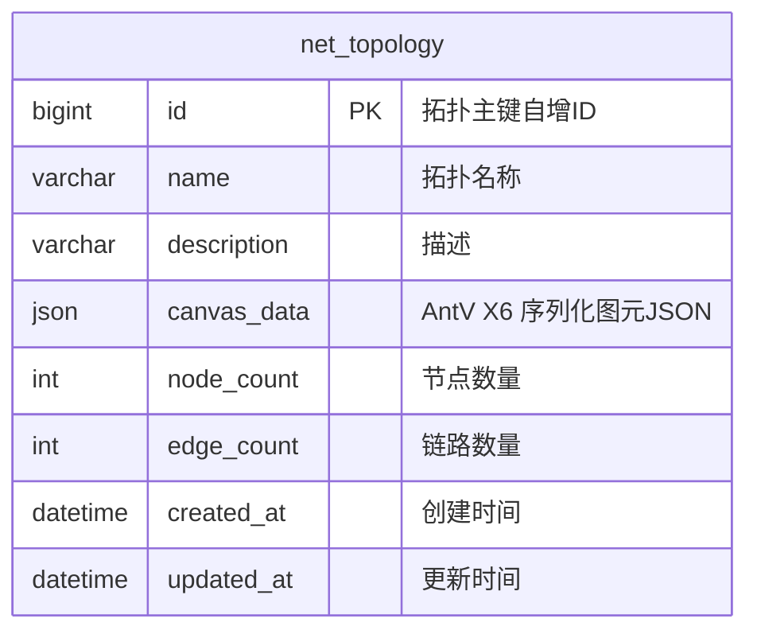

# 📜 [DLD-NET-01] 网络拓扑仿真系统详细设计说明书 (Detailed Design)

> 严格遵循【钧天科技 V1.0 架构标准】详细设计说明书 7 大章节规约，精确锁定接口契约、数据库 DDL、算法核心类设计与测试用例先行标准。

---

## 1. 修订历史 (Revision History)

| 编号 | 章节名称 | 修订内容描述 | 修订日期 | 修订版本 | 修订人 |
| :--- | :--- | :--- | :--- | :--- | :--- |
| 1 | 全部章节 | 初始发布：拓扑数据结构、接口契约与 MySQL 表设计 | 2026-10-24 | V1.0 | 详细设计专家 |

---

## 2. 概述与总体约束 (Overview & Constraints)

### 2.1 架构分层映射
- `platform-common`: 全局异常 `BusinessException`、状态码枚举 `ResultCode`、统一返回包装 `Result<T>`。
- `module-network-sim`:
  - `controller`: `TopologyController.java` (对外暴露拓扑存取与仿真测试 API)
  - `service`: `TopologyService.java`、`BfsRoutingEngine.java`、`AclMatcher.java`
  - `dao` / `mapper`: `NetTopologyMapper.java` (MyBatis-Plus)
  - `entity` / `dto`: `NetTopology.java`, `SimulationRequestDTO.java`, `SimulationResultVO.java`
- `platform-server`: 聚合主程序 `PlatformApplication.java` 与配置文件。

---

## 3. 核心领域模型与算法类设计 (Domain Models & Algorithm)

### 3.1 核心数据结构设计 (Java 17 Records / Classes)

```java
// 拓扑节点 (对齐 Flowsint 工业电力仿真规范)
public record TopoNode(
    String id,              // 节点唯一 ID (node_xxx)
    String name,            // 设备名称 (研发办公PC, 工业核心防火墙, TDengine时序库)
    String type,            // HOST, SWITCH, ROUTER, FIREWALL, GATEWAY, NEURON, TDENGINE, SENSOR, SERVER
    String zone,            // 所属安全大区: IT_ZONE (管理大区), DMZ_ZONE (隔离区), OT_ZONE (生产控制), PHY_ZONE (物理层)
    String ip,              // IP 地址 (如 192.168.1.10, 10.1.1.5)
    String subnet,          // 子网掩码 (如 255.255.255.0)
    List<AclRule> acls      // 该节点配置的 ACL 规则列表
) {}

// 拓扑边/链路
public record TopoEdge(
    String id,              // 连线 ID
    String sourceNodeId,    // 源节点 ID
    String targetNodeId,    // 目的节点 ID
    String bandwidth,       // 带宽 (如 1Gbps)
    Integer latencyMs       // 链路延时 (毫秒)
) {}

// ACL 安全过滤规则
public record AclRule(
    String id,              // 规则唯一标识 (acl_1)
    Integer priority,       // 规则优先级 (1~1000，越小越优先)
    String action,          // PERMIT (放行) / DENY (拦截阻断)
    String srcIp,           // 源 IP 或 CIDR (如 192.168.1.0/24)
    String destIp,          // 目的 IP 或 CIDR
    Integer destPort,       // 目标端口 (如 80, 3306)
    String protocol,        // TCP, UDP, ICMP, ANY
    String description      // 规则白话说明
) {}
```

### 3.2 BFS 寻路与 ACL 匹配算法核心流程
1. **构建邻接表**：基于 `TopoEdge` 构建无向或有向双向连通图 `Map<String, List<TopoEdge>> adjacencyMap`。
2. **BFS 队列搜索**：维护 `Queue<PathState>`，其中 `PathState` 包含当前节点及截至目前的完整路径列表。
3. **ACL 短路拦截器**：
   - 当下一跳节点类型为 `FIREWALL` 或配置有 `acls` 时，按 `priority` 升序遍历 `acls`；
   - 若匹配源 IP、目的 IP、目的端口及协议：
     - 若 `action == "DENY"`：产生一条拦截日志，将该搜索分支剪枝；
     - 若 `action == "PERMIT"`：放行，继续压入队列；
   - 若全部规则未命中：执行**默认放行策略 (Default Permit)**。

---

## 4. 接口详细设计 (RESTful API Specification)

### 4.1 接口列表总览

| 接口名称 | HTTP Method | 请求路径 (URL) | 功能说明 |
| :--- | :--- | :--- | :--- |
| **保存/更新拓扑** | `POST` | `/api/v1/network-sim/topology` | 序列化保存画布 JSON 到 MySQL |
| **获取拓扑详情** | `GET` | `/api/v1/network-sim/topology/{id}` | 读取拓扑画布数据供前端回显 |
| **发起连通性测试** | `POST` | `/api/v1/network-sim/simulate/connectivity` | 触发 BFS 寻路与 ACL 过滤测试 |

### 4.2 接口 1：保存拓扑 (`POST /api/v1/network-sim/topology`)
- **请求体 (Request JSON)**：
```json
{
  "name": "企业研发内网拓扑",
  "description": "包含办公网、DMZ 防火墙与生产服务器",
  "canvasData": "{\"cells\": [...]}"
}
```
- **响应体 (Response JSON)**：
```json
{
  "code": 200,
  "message": "保存成功",
  "data": {
    "id": 1,
    "name": "企业研发内网拓扑",
    "updatedAt": "2026-10-24 13:30:00"
  }
}
```

### 4.3 接口 2：发起 BFS 连通性测试 (`POST /api/v1/network-sim/simulate/connectivity`)
- **请求体 (Request JSON)**：
```json
{
  "topologyId": 1,
  "canvasData": null,
  "sourceNodeId": "node_host_a",
  "targetNodeId": "node_server_b",
  "destPort": 3306,
  "protocol": "TCP"
}
```
- **响应体 (成功连通 - Response JSON)**：
```json
{
  "code": 200,
  "message": "仿真执行完毕",
  "data": {
    "reachable": true,
    "blocked": false,
    "hops": 3,
    "totalLatencyMs": 15,
    "nodePath": ["node_host_a", "node_sw_1", "node_fw_1", "node_server_b"],
    "logs": [
      "[INFO] 开始从 主机A(192.168.1.10) 寻路至 服务器B(10.0.0.88)",
      "[INFO] 途径交换机 SW-1，完成二层转发",
      "[INFO] 到达防火墙 FW-1: 匹配默认策略 (PERMIT)，允许放行",
      "[SUCCESS] 顺利抵达目的节点 服务器B，网络可达！"
    ]
  }
}
```
- **响应体 (ACL 拦截 - Response JSON)**：
```json
{
  "code": 200,
  "message": "仿真执行完毕",
  "data": {
    "reachable": false,
    "blocked": true,
    "blockedNodeId": "node_fw_1",
    "blockedRuleId": "acl_1",
    "nodePath": ["node_host_a", "node_sw_1", "node_fw_1"],
    "logs": [
      "[INFO] 开始从 主机A(192.168.1.10) 寻路至 服务器B(10.0.0.88)",
      "[WARN] 数据包到达防火墙 FW-1",
      "[ERROR] 命中 ACL 拦截规则 [acl_1]: DENY (目标端口: 3306, 描述: 禁止访问数据库)",
      "[ERROR] 数据包被强制阻断，连通性测试失败！"
    ]
  }
}
```

---

## 5. 数据库详细设计 (Database & Schema)

### 5.1 实体关系 ER 图 (Mermaid)



### 5.2 数据表结构定义 (`net_topology`)

```sql
CREATE TABLE IF NOT EXISTS `net_topology` (
  `id` BIGINT NOT NULL AUTO_INCREMENT COMMENT '拓扑主键ID',
  `name` VARCHAR(128) NOT NULL COMMENT '拓扑名称',
  `description` VARCHAR(512) DEFAULT NULL COMMENT '拓扑描述',
  `canvas_data` LONGTEXT NOT NULL COMMENT '前端 AntV X6 序列化画布数据 (JSON格式)',
  `node_count` INT DEFAULT 0 COMMENT '包含设备节点数',
  `edge_count` INT DEFAULT 0 COMMENT '包含物理连线数',
  `created_at` DATETIME NOT NULL DEFAULT CURRENT_TIMESTAMP COMMENT '创建时间',
  `updated_at` DATETIME NOT NULL DEFAULT CURRENT_TIMESTAMP ON UPDATE CURRENT_TIMESTAMP COMMENT '更新时间',
  PRIMARY KEY (`id`),
  KEY `idx_name` (`name`)
) ENGINE=InnoDB DEFAULT CHARSET=utf8mb4 COLLATE=utf8mb4_unicode_ci COMMENT='网络拓扑图元存储表';
```

---

## 6. 非功能详细设计 (Non-Functional Requirements)
- **短路阻断**：ACL 匹配采用从前至后顺序短路机制，命中即返回结果，防止无谓运算。
- **环路防护**：采用 `HashSet<String> visited` 记录已遍历节点，防止环路产生死循环；最大跳数超 50 自动判定超限阻断。

---

## 7. 风险应对 (Risk Management)

| 风险情景 | 防御设计 |
| :--- | :--- |
| **前端传入的拓扑缺少起点或终点** | 后端校验参数，找不到对应节点直接抛出 `BusinessException("源节点或目标节点不存在")`。 |
| **画布 JSON 体积超过数据库列限制** | MySQL 采用 `LONGTEXT`（最大 4GB）存储，支持千万级节点的大型网络拓扑导出。 |
