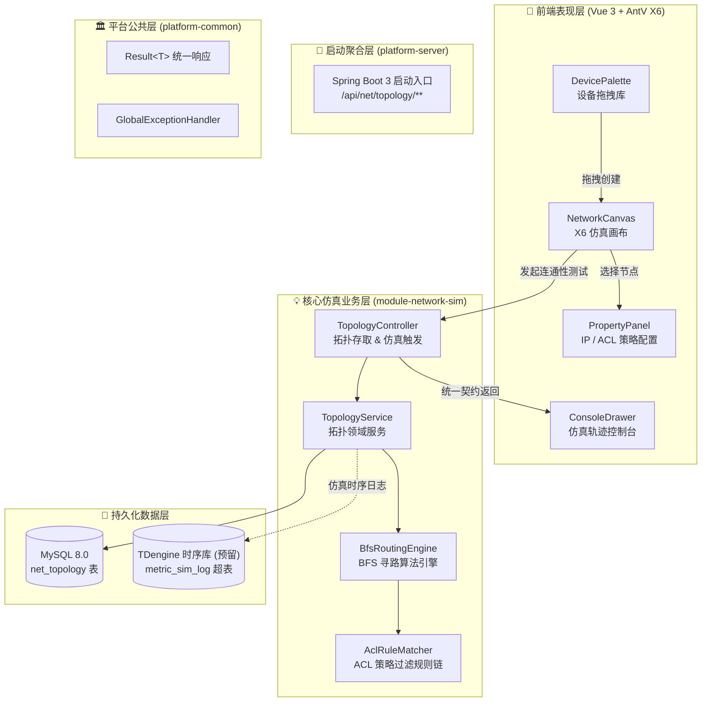
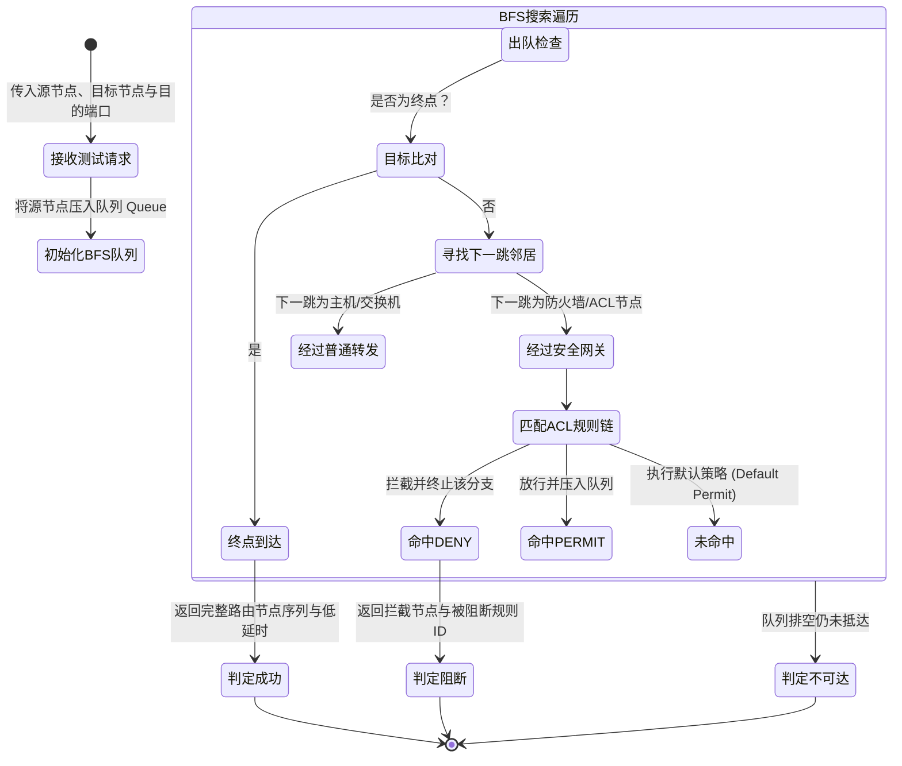

# 📐 [HLD-NET-01] 网络拓扑仿真系统概要设计说明书 (High-Level Design)

> 遵循【钧天科技 V1.0 架构标准】8 大章节规约，系统性阐述个人多模块学习平台 (Learning Platform) 首个核心子模块——网络拓扑仿真系统 (Module-Network-Sim) 的总体架构。

---

## 1. 修订历史 (Revision History)

| 版本号 | 修订日期 | 修订内容概述 | 修订人 | 审核状态 |
| :--- | :--- | :--- | :--- | :--- |
| **V1.0** | 2026-10-24 | 初始版本发布：确立多模块单体拆分、AntV X6 前端集成与后端纯 Java BFS+ACL 引擎设计 | 架构设计专家 | 🟢 评审通过 |

---

## 2. 概述 (Introduction)

### 2.1 设计目的
构建一套高可扩展、业务解耦的可视化网络仿真系统，实现从“Web 端拖拽绘制有向网络拓扑”到“后端内存图构建、广度优先搜索寻路及防火墙安全规则拦截”的全链路仿真闭环，并为未来接入 TDengine 时序存储与 Linux 内核级容器沙箱预留架构骨架。

### 2.2 核心术语表
- **BFS (Breadth-First Search)**：广度优先搜索算法，用于有向拓扑图中查找从源节点到目的节点的最短跳数路由路径。
- **ACL (Access Control List)**：访问控制列表，包含规则优先级、协议、源/目的网段、端口及动作 (`PERMIT`/`DENY`)。
- **Modular Monolith**：模块化单体架构，通过 Maven 多模块严格隔离业务依赖，由单启动类统一聚合运行。

---

## 3. 总体设计 (Architecture Design)

### 3.1 技术选型矩阵表

| 分层维度 | 技术选型 | 版本规格 | 选型核心考量 |
| :--- | :--- | :--- | :--- |
| **服务端框架** | Spring Boot | 3.2.4 (Java 17) | 现代企业级开发标准，模块化依赖注入与轻量运行 |
| **持久层框架** | MyBatis-Plus | 3.5.7 | 极简 CRUD 与动态 Lambda 查询构造能力 |
| **主关系库** | MySQL | 8.0+ | 存储拓扑元数据与序列化 JSON 结构 (net_topology 表) |
| **时序数据库** | TDengine (预留) | 3.0+ | 高性能写入网络仿真测试过程中的延时、丢包指标与时间序列事件 |
| **前端框架** | Vue 3 + TypeScript | 3.4+ / Vite 5 | 强类型现代化响应式前端，支持模块物理目录隔离 |
| **拓扑可视化** | AntV X6 | 2.1+ | 阿里巴巴企业级图编辑引擎，支持自定义 HTML 节点、端口对齐与路径高亮 |
| **组件库** | Element Plus | 2.7+ | 支撑右侧属性抽屉、ACL 规则配置表单与弹窗控制 |

### 3.2 总体模块交互架构图 (Mermaid)

---

## 4. 功能模块设计 (Functional Architecture)

### 4.1 拓扑图编辑与持久化子模块
- **序列化模型**：前端通过 `graph.toJSON()` 生成包含 `cells` (节点与边) 的 JSON 文本；后端将其存入 `net_topology.canvas_data` 字段（`LONGTEXT` 或 `JSON` 类型）。
- **生命周期**：新建拓扑 ➔ 画布拖拽连线 ➔ 配置各节点 IP/网段 ➔ 点击保存同步 MySQL。

### 4.2 BFS 连通性寻路与安全拦截子模块
- **构图推演**：从 JSON 中解析节点表与邻接表，构建 `Map<String, List<Edge>>` 内存有向邻接表。
- **状态流转**：

---

## 5. 接口设计原则 (API Principles)
- **RESTful 统一规范**：所有 API 均以 `/api/v1/network-sim/` 为前缀。
- **统一响应格式**：强制使用 `platform-common` 模块的 `Result<T>` 泛型包装。
- **无状态调用**：仿真测试请求为无状态幂等操作，仅基于当前提交或持久化的拓扑数据进行内存即时推演。

---

## 6. 数据存储方案 (Storage Design)
- **实时/元数据**：采用 MySQL 8.0 存储拓扑名称、创建人、所属项目及画布完整 JSON 描述。
- **指标/审计日志**：采用内存队列暂存仿真结果；预留 TDengine 超表 `st_net_sim_metric` 记录每一次测试的源 IP、目的 IP、跳数、耗时及是否被拦截。

---

## 7. 部署与环境约束 (Deployment)
- **开发环境**：JDK 17 + Node.js 18+ + MySQL 8.0。
- **运行模式**：开发期以本地 Maven 多模块 `platform-server` 聚合模式启动，前端 Vite 代理转发 `/api` 流量。

---

## 8. 非功能与风险应对 (Risk Management)

| 风险点 | 风险等级 | 应对措施与设计体现 |
| :--- | :--- | :--- |
| **拓扑环路导致 BFS 死循环** | 高 | 算法中强制使用 `Set<String> visited` 记录已遍历节点，禁止重复入队；限制最大寻路跳数 (如 Max 50 跳)。 |
| **大拓扑 JSON 解析性能瓶颈** | 中 | 采用 Jackson 高性能流式解析，图构建完成后在单线程内毫秒级完成 BFS 拓扑遍历。 |
| **ACL 规则冲突与顺序错乱** | 中 | ACL 规则引入强排序属性 `priority` (数字越小优先级越高)，按顺序短路匹配。 |
