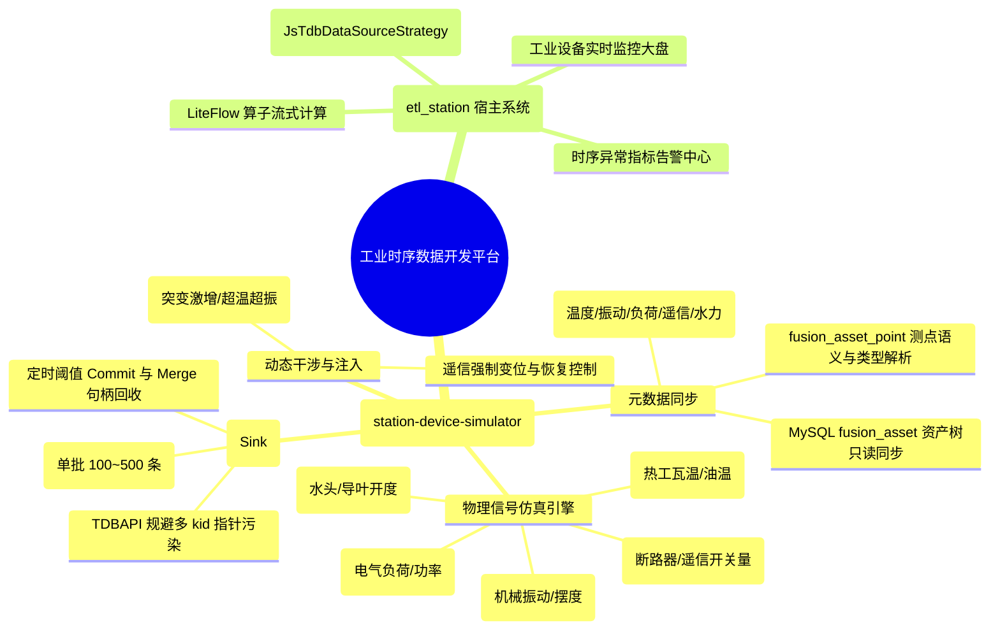

# 🧭 系统需求全景地图 (Requirements Map)

> **项目名称**: 工业数据智能分析与开发平台 (Apex / etl_station)  
> **基线版本**: V1.0  
> **最后更新**: 2026-10-22  
> **状态**: ACTIVE  

---

## 1. 业务全景拓扑 (System Capability Map)

---

## 2. 核心模块需求矩阵

| 模块编码 | 模块名称 | 核心职责 | 状态 | 关联架构/设计文档 |
| :--- | :--- | :--- | :--- | :--- |
| **MOD-01** | `simulator-metadata` | 从 MySQL `etl_badger` 只读拉取 `fusion_asset` 及测点元数据，并向内存注册中心登记。 | 🟢 已交付 | [HLD](docs/design/hld-station-device-simulator-v1.0.md), [DLD](docs/design/dld-station-device-simulator-v1.0.md) |
| **MOD-02** | `simulator-core` | 点位特征化物理波形计算引擎、无锁上一时刻状态缓存、定时 Tick 调度器与故障注入。 | 🟢 已交付 | [HLD](docs/design/hld-station-device-simulator-v1.0.md), [DLD](docs/design/dld-station-device-simulator-v1.0.md) |
| **MOD-03** | `simulator-sink-jsdb` | 封装极生时序写入能力，严格单点并发，批量刷新入库并维护 Commit/Merge 句柄。 | 🟢 已交付 | [HLD](docs/design/hld-station-device-simulator-v1.0.md), [DLD](docs/design/dld-station-device-simulator-v1.0.md) |
| **MOD-04** | `simulator-starter` | Spring Boot 独立启动器，提供 REST 监控与故障干涉端点，加载应用配置。 | 🟢 已交付 | [HLD](docs/design/hld-station-device-simulator-v1.0.md), [DLD](docs/design/dld-station-device-simulator-v1.0.md) |
| **MOD-05** | `simulator-console` | 前端可视化数字孪生控制台（4层资产树/多通道/事故演练/时延标尺）。 | 🟢 已交付 | [PRD](docs/modules/simulator_console/prd-simulator-console-v1.0.md), [Mockup](docs/modules/simulator_console/mockup.html) |

---

## 3. 需求红线与不可触碰边界 (Anti-Patterns)

1. **零污染写操作**：严禁向 MySQL `fusion_asset` 及业务表发起任何 `INSERT` / `UPDATE` / `DELETE` 语句，只读不写。
2. **规避 JNI 指针缺陷**：严格遵守踩坑记录 P-014 及 DECISION_LOG 2026-09-14，严禁在 `TDBAPI.insert` 中混入不规则的多 kid 嵌套数组，杜绝数据交叉污染。
3. **真实物理平滑度**：温升、负荷等大惯性物理量禁止直接生成瞬态断崖随机数，必须使用一阶惯性滞后函数平滑推进。
