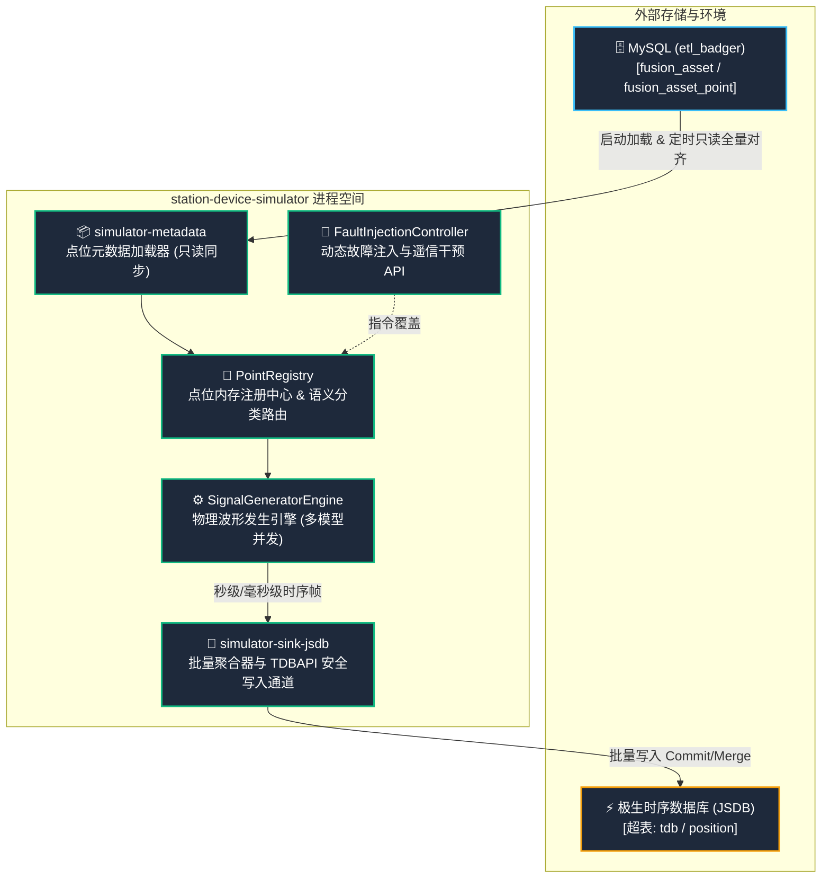
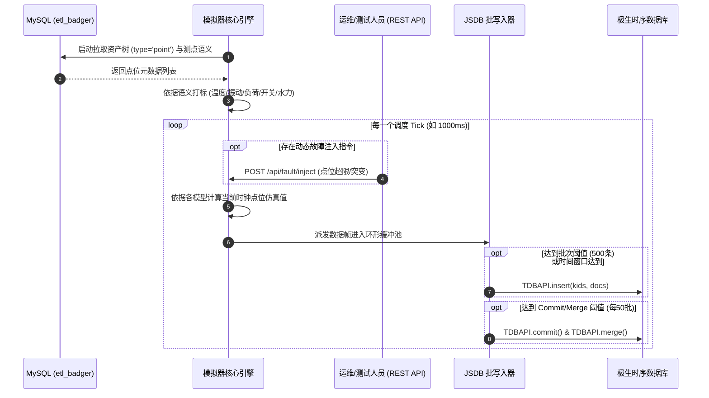

# 独立电站设备模拟服务 (Station Device Simulator) 概要设计说明书 (HLD)

---

## 📋 文件修订页 (Revision History)

| 编号 | 章节名称 | 修订内容描述 | 修订日期 | 修订版本 | 修订人 |
| :--- | :--- | :--- | :--- | :--- | :--- |
| 1 | 所有章节 | 基于方案与对齐基线创建系统概要设计说明书 | 2026-10-22 | V1.0 | AI Agent |

---

## 1 概述

### 1.1 编写目的
本文档明确独立电站设备数据模拟服务（`station-device-simulator`）的宏观技术架构、各模块职责划分、内外部数据流交互规范以及关键设计原则，作为系统实现的顶层设计指南。

### 1.2 术语与定义
| 序号 | 术语 | 定义 |
| :--- | :--- | :--- |
| 1 | HLD | 概要设计说明书 (High-Level Design) |
| 2 | SSOT | 单一真实信任源 (Single Source of Truth)，本文指 MySQL 中的 `fusion_asset` 与测点表 |
| 3 | JSDB | 极生时序数据库，用于存储海量工业测点高频时序数据 |
| 4 | Lag Filter | 一阶惯性滞后滤波算法，模拟热工大惯性物理量缓慢上升与衰减 |
| 5 | Markov Chain | 马尔可夫链模型，用于模拟电力系统开关遥信量的稳态与随机跃迁 |

### 1.3 参考资料与标准
| 序号 | 标准名称 / 参考资料 | 标准文号 / 来源 |
| :--- | :--- | :--- |
| 1 | 《独立电站设备模拟服务方案》 | [方案文档](docs/design/独立电站设备模拟服务方案.md) |
| 2 | 《国家电网公司应用软件架构设计规范》 | OS-L3-SD57-01 |
| 3 | 《Sentinel-K 内核规范与踩坑账本》 | `PITFALLS.md` / `DECISION_LOG.md` |

---

## 2 系统总体设计

### 2.1 设计原则
- **物理与进程强隔离**：模拟服务独立打包部署，拥有独立的 JVM 进程与内存堆栈，其高频生成与批处理不挤占宿主 `etl_station` 平台的算子计算与业务吞吐。
- **元数据同源共享 (SSOT)**：与主平台共享 MySQL 测点定义，只读拉取，避免维护两套点位信息造成的数据脱节。
- **高拟真物理建模**：杜绝粗制随机数，按热工量、机械振动、电气负荷、离散遥信分别匹配真实的物理与数学模型。
- **安全写入与驱动缺陷规避**：严格单点并发封装极生驱动，规避底层 C 驱动多 kid 指针交叉污染。

### 2.2 核心技术选型
| 分类 | 选型方案 | 选型说明 |
| :--- | :--- | :--- |
| 核心框架 | Java 17 + Spring Boot 3.3.x | 现代化轻量后端运行时 |
| 数据持久层 (读) | MyBatis-Plus 3.5.x | 只读访问 MySQL 8.0 `etl_badger` |
| 时序数据库 (写) | 极生时序驱动 (`jsdb-1.0.0.jar`, `pydk-1.0.0.jar`) | 通过 JNI / Socket 写入极生时序库 |
| 并发与调度 | Disruptor / J.U.C 无锁环形缓冲区 + ScheduledExecutor | 支撑万级点位每秒并发仿真运算与批量下刷 |
| API 交互 | Spring Web MVC | 提供 REST 监控探针与故障干涉入口 |

### 2.3 总体架构设计

#### 2.3.1 架构拓扑图

#### 2.3.2 系统数据流图 (Data Flow)

---

## 3 功能模块划分与设计

### 3.1 `simulator-metadata-spi` & `simulator-metadata-mysql`
- **模块职责**：定义点位元数据抽取抽象接口（SPI），并基于 MySQL 提供实现。
- **数据流转**：系统初始化或收到刷新信号时，只读扫描 `fusion_asset` 及 `fusion_asset_point`，构建内存设备-测点树形上下文。

### 3.2 `simulator-core`
- **模块职责**：
  - **点位策略分发器 (Signal Strategy Router)**：根据点位中文语义或名称（如“瓦温”、“振动”、“断路器”）自动映射至计算函数。
  - **物理波形算法集**：实现一阶惯性滞后函数、工频叠加正弦波与白噪声、马尔可夫离散跳变等。
  - **无锁状态暂存器**：记录各点位历史数值、当前趋势方向与故障注入倒计时。

### 3.3 `simulator-sink-spi` & `simulator-sink-jsdb`
- **模块职责**：
  - 抽象时序写入 SPI。
  - 实现 JSDB 安全批量写入，严格保证单点批次写入，防止指针混淆。
  - 维护句柄生命周期，定期执行 `commit` 和 `merge`，保证极生服务稳定。

### 3.4 `simulator-starter`
- **模块职责**：工程组装与主入口。提供 `application.yml` 参数配置（MySQL 连接串、JSDB IP/Port、推流频率）及 REST 控制端点。

### 3.5 可视化监控与评判控制台 (`simulator_console`)
- **模块职责**：为数据分析与算法人员提供可视化界面，直接映射原型 [mockup.html](docs/modules/simulator_console/mockup.html)。
- **核心交互**：
  - 动态呈现推流波形及发送给极生的 10位/13位底层真实数据帧；
  - 动态故障突变注入（高温越限、机械剧烈振动、断路器变位）；
  - 并列呈现宿主数据分析平台算子输出与告警评判结果，形成“发数-评判-归因”闭环。

