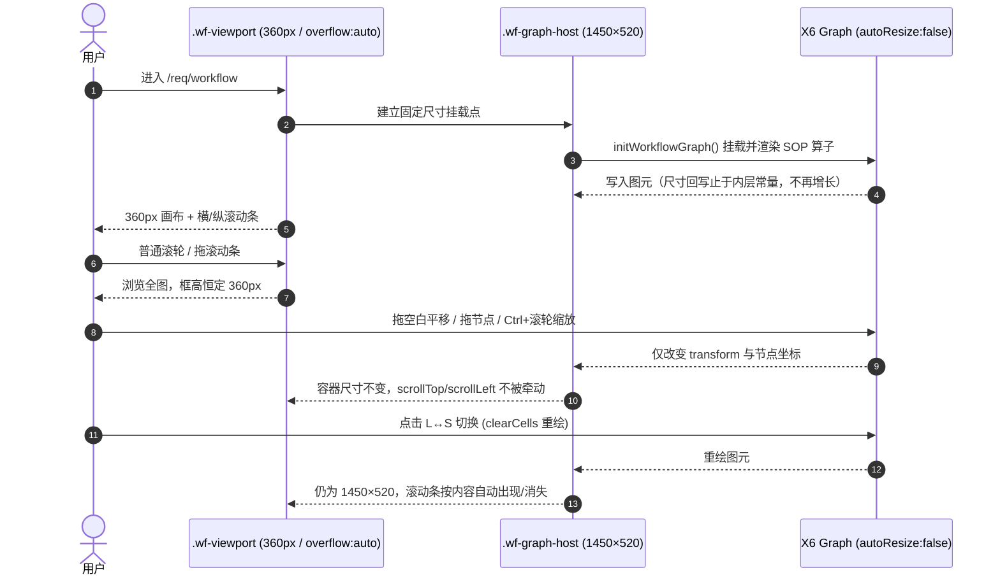

# 📐 模块施工图: 工程流水线拓扑画布可视区治理 (req-management · 纯前端迭代)

> **设计模式**：模式 A（只写模块施工图，**不动** `docs/02-architecture.md`）
> **关联看板**：`Task-510` / `Task-511` / `Task-512` ｜ **需求**：`FR-REQ-WFC-01`
> **上游契约**：[`prd-workflow-canvas-viewport-v1.0.md`](../../modules/req-management/prd-workflow-canvas-viewport-v1.0.md) ｜ [`srs.md`](../../srs/workflow-canvas-viewport/srs.md)
> **主模块施工图**：[`detail.md`](detail.md)（本次迭代**不改动**其表结构与 REST 契约）
> **依据**：`.ai/sop/02-sop-tech-design.md` · 模式 A · 契约冻结于编码之前

---

## 1. 版本变更历史

| 版本 | 日期 | 关联 Task | 关键决策摘要 |
| :--- | :--- | :--- | :--- |
| `v1.0.0` | 2026-11-06 | `Task-510` | 冻结两层 DOM 结构、360px 可视框常量、`autoResize:false` 与原生滚动条方案，决掉 SRS 的 TD-01~05 |

---

## 2. 上下游依赖与影响范围自判

| 项 | 结论 |
| :--- | :--- |
| 唯一改动文件 | `base_template/frontend/src/modules/req-management/views/ReqManagementView.vue` |
| 容器引用面 | `workflowGraphContainer` 仅被 `initWorkflowGraph()` 引用（:127/:132/:140）；`renderWorkflowGraphData()` 被多处调用但只 `clearCells/addNode`，不碰容器尺寸 |
| 上游 | 路由 `/req/workflow` → `Layout.vue` 全屏模式（**本次不改**） |
| 下游 | 「B1~B6 旁路矩阵」等下方面板（**本次不改**，仅因画布不再膨胀而恢复可见） |
| 公共资产 | 未触碰 Base / 拦截器 / 全局配置 / 通用 `R<T>`，**无需全量回归** |
| 依赖 | 不新增、不升级；`@antv/x6 ^2.19.2` 保持不变 |

---

## 3. 待决技术项冻结（SRS §9 的 TD-01~05）

| 编号 | 冻结结论 | 取舍依据 |
| :--- | :--- | :--- |
| `TD-01` | **两层 DOM + 关闭 `autoResize`**：外层 `.wf-viewport` 固定 360px 且 `overflow:auto`；内层 `.wf-graph-host` 作为 X6 挂载点，尺寸由常量显式给定。Graph 配置 `autoResize:false` + `width/height` 显式赋值 | X6 只会回写**内层**尺寸，而内层不再被监听且值是常量 → 正反馈链从源头断开；可视框永远碰不到 X6。仅改 CSS 不切断回写是假修复（实测反例） |
| `TD-02` | **原生 `overflow:auto` 滚动条**，不引入 `@antv/x6-plugin-scroller` | 项目「零新依赖」铁律；`package.json` 当前未装该插件；原生滚动已满足 `SRS-05/06/08` |
| `TD-03` | 尺寸**单点声明**：`360px` 只在 CSS `.wf-viewport` 一处；`1450/520` 只在 `<script setup>` 的 `WORKFLOW_CANVAS` 常量一处，同时供内层 `:style` 与 Graph 配置使用 | 避免多处各写一份导致漂移（`SRS` 非功能约束） |
| `TD-04` | **不做事件拦截**：平移由 X6 `panning`（内部 transform）承担，滚动由外层 DOM `overflow` 承担，天然互不影响；保持 `mousewheel.modifiers:['ctrl','meta']` —— 普通滚轮归滚动条、Ctrl/⌘ 归缩放 | 满足 `SRS-10/13`「平移不牵动 scrollTop/scrollLeft」，改动最小 |
| `TD-05` | `translating.restrict` 由 `{0,0,1450,210}` 改为 `{0,0,1450,520}`，语义明确为**内容边界**而非可视框 | 旧 210 会把节点锁在旧高度内，内容画布放大后看不到下半部分 |

**新增决策 `TD-06`（内容画布尺寸）**：固定 `1450 × 520`。依据真实节点包围盒 —— L 级阶段底框最高 `y=15+175=190`，S 级旁路大区最高 `y=20+380=400`，取 520 留 120px 网格留白，使 360px 可视框有 160px 真实纵向滚动行程，同时不产生大片空白。
> 交互原型 `mockup-workflow-canvas-viewport.html` 把内容画布画成 `1450×820` 是**为演示滚动条而放大的示意值**，不是生产契约；验收口径以本施工图的 520 为准，PRD/SRS 从未写死该数值。

---

## 4. 冻结契约（编码前锁定，改字段先改本文件）

### 4.1 DOM 结构

```html
<!-- 外层：可视框。尺寸只由 CSS 决定，X6 永不接触 -->
<div class="wf-viewport">
  <!-- 内层：X6 挂载点。尺寸由 WORKFLOW_CANVAS 常量 :style 绑定 -->
  <div ref="workflowGraphContainer" class="wf-graph-host"
       :style="{ width: WORKFLOW_CANVAS.width + 'px', height: WORKFLOW_CANVAS.height + 'px' }"></div>
</div>
```

### 4.2 尺寸与样式契约

| 契约项 | 冻结值 | 约束 |
| :--- | :--- | :--- |
| `.wf-viewport` | `height:360px; width:100%; overflow:auto` | 唯一决定可视区尺寸；不得出现 `height:100%` / `min-height` 等可变声明 |
| `.wf-graph-host` | `1450 × 520 px` | 由 `:style` 绑定常量；不得用百分比 |
| 滚动条可见性 | `scrollbar-color:#3b4d68 #0b1320; scrollbar-width:thin` + webkit 伪元素 | 暗色画布上必须可辨识 |
| `WORKFLOW_CANVAS` | `{ width: 1450, height: 520 }` | 同时供 `:style` 与 Graph 配置，禁止复制字面量 |

### 4.3 Graph 配置契约

| 配置项 | 冻结值 | 变更 |
| :--- | :--- | :--- |
| `container` | `workflowGraphContainer.value` | 不变 |
| `autoResize` | `false` | **由 true 改为 false**（切断正反馈） |
| `width` / `height` | `WORKFLOW_CANVAS.width` / `.height` | 由「只给 height:210」改为显式双值 |
| `panning` | `{ enabled:true, eventTypes:['leftMouseDown'] }` | 不变 |
| `mousewheel` | `{ enabled:true, modifiers:['ctrl','meta'] }` | 不变 |
| `translating.restrict` | `{ x:0, y:0, width:WORKFLOW_CANVAS.width, height:WORKFLOW_CANVAS.height }`（等价 1450 / 520，实现以常量绑定以满足单点声明） | 由硬编码 210 改为绑定常量，语义为内容边界 |
| `interacting` | `{ nodeMovable:true, edgeMovable:false }` | 不变 |
| `grid` / `background` | 原值 | 不变 |

### 4.4 端到端时序（纯前端，无接口）



---

## 5. 标准 5 节的裁剪说明（纯前端迭代）

| SOP [2] 必含节 | 本次处理 |
| :--- | :--- |
| 版本变更历史 | 见 §1 |
| 端到端时序流 | 见 §4.4（调用方→可视框→X6，无服务端/DB） |
| 接口契约 | **豁免**：不新增/不修改任何 REST 接口，无入参、响应 Schema 与错误码 |
| 数据模型 | **豁免**：不新增表、不改字段、不加索引 |
| SQL 配对 | **豁免**：无 Migration，故不需要 `V*.sql` / `rollback_V*.sql` |

> 不写假大空的占位接口与空 SQL；豁免理由已在此留痕，供 `[4]` 代码审查门禁比对。

---

## 6. 回滚预案与验证锚点

- **回滚**：单文件改动，`git checkout -- base_template/frontend/src/modules/req-management/views/ReqManagementView.vue` 即可完全还原；无数据/接口/依赖残留。
- **验证锚点**：`scripts/tests/test_workflow_canvas_viewport.py`（静态契约探针）+ 浏览器运行时探针（3 秒尺寸采样 / 滚动可达 / 平移不改滚动偏移 / L↔S 切换后恒定），对应 `TC-WFC-*` 与 `SRS-01/02/05/10/14`。
- **TDD 顺序**：先落探针并确认红灯 → 再按本施工图做最小实现 → 复跑转绿；严禁先实现后补必然通过的测试。

---

## 7. 后续 B2 快修演进（2026-11-06 15:50~16:27 · 契约补充）

> 本节记录 `[3]` 之后经 `[B2]` 旁路完成的四轮实际改动。它们**未改 API / Entity / Schema**，但改了布局 JS 与 DOM 结构，按「Solid 资产留痕」补进施工图，作为 `[4]` 审查与 `[7]` 验收的比对基准。

### 7.1 四轮改动一览

| 轮次 | 用户反馈 | 根因 | 修复 | 证据 |
| :--- | :--- | :--- | :--- | :--- |
| ① 15:50 | 右侧「里程碑交付发布区」被裁 | `grid 320px 1fr` 右列 `min-width:auto` 被内层 1450px 撑到 1497px，被 `.app-content{overflow:hidden}` 裁掉 | 右列加 `min-width:0`，横向滚动条回到画布内 | `workflow-canvas-rightside-verified.png` |
| ② 15:59 | 宽度没适配整个屏幕 | 左侧 320px 需求列表占一列，画布卡片仅 623px | 外层改 `flex column`，`order:1/2` 让画布独占整行、列表移下方，列表内部 `grid auto-fill` | `workflow-canvas-fullwidth-verified.png` |
| ③ 16:07 | 右侧仍有大片空白 | 节点坐标硬编码在 `1450×~200`，可视框仅 950px | 新增 `relayoutWorkflowGraph()`：移除 `zone_*` 大区框，按可视框宽度算列数折行居中铺满；host 宽 100%、高按行数动态；标签改「自适应折行铺满」 | `workflow-canvas-autolayout-verified.png` |
| ④ 16:23 | 首屏不对、点按钮才好 | relayout 用 DOM API 写 `host.style.height`，与 Vue `:style`（520px）打架，被响应式刷新覆盖 | 高度改由响应式 `workflowHostHeight` 托管；新增 `ResizeObserver` 观察可视框自动收敛 | `workflow-canvas-init-verified.png` |

### 7.2 现行最终形态（`[4]` 审查基准）

- DOM：`.wf-viewport`（360px / `overflow:auto`）→ `.wf-graph-host`（`width:100%`、高度由 `workflowHostHeight` 响应式给出）→ X6 svg。
- `WORKFLOW_CANVAS = { width: 1450, height: 520 }` **保留为 X6 逻辑画布尺寸**，仅用于 Graph 配置与 `translating.restrict`；不再作为挂载点的固定像素宽高。
- 折行算法：`cols = max(4, floor((viewport.clientWidth - 24) / 155))`，`node.position()` 按 `cellW` 居中，`y = 26 + row*118`，`workflowHostHeight = rows*118 + 30`。
- 稳定性：`ResizeObserver` 观察 `.wf-viewport`（首屏 observe 立即回调 + 窗口/布局变化兜底），`window.resize` 监听并存，`onUnmounted` 全部清理。
- 未动：硬编码节点坐标、Graph 配置、`autoResize:false`、`translating.restrict`、零新依赖、`Layout.vue`。
- **17:46 防御兜底**：① 折行宽度取 `min(vp.clientWidth, vp.getBoundingClientRect().width)`，避免任一祖先被撑宽时算错列数；② 挂载点高度改为 `max(rows*rowH+30, 真实节点最大 bottom+26)`，即使行数计算异常也绝不把最后一行裁掉。实测 1000/1100/1280/1600/1920 五种视口 `hidden=0`、画布内 `canScroll=false`。
- **18:12 平移自愈**：用户截图「节点只露上半截、下方大片空白」与画布被左键拖动 pan 出可视框的表现吻合（`panning.enabled:true` 是 `[1]` 阶段用户拍板保留的能力，此前无任何恢复手段）。补两道防线：① `relayoutWorkflowGraph()` 末尾 `graph.translate(0,0)`，重绘/折行/resize 时自动复位平移；② 画布头部新增「🎯 重置视图」按钮（`resetWorkflowView()`：`translate(0,0)` + `zoomTo(1)`），拖乱后一键恢复。

### 7.3 已知副作用（验收须知）

1. 原 4 个虚线大区框在折行布局下不再绘制；节点颜色仍区分阶段，卡片标签已同步为「自适应折行铺满」。
2. 跨行连线由 X6 自动路由成斜线，流程顺序仍可读。
3. 若需按行分组框或蛇形连线，并入 `FR-REQ-WFC-02` 的数据驱动布局算法，不在本需求内处理。

### 7.4 回滚与验证锚点（更新）

- 回滚仍为单文件：`git checkout -- base_template/frontend/src/modules/req-management/views/ReqManagementView.vue`。
- 探针由 8 条扩展为 12 条（`scripts/tests/test_workflow_canvas_viewport.py`），新增 `relayoutWorkflowGraph` / `workflowHostHeight` / `ResizeObserver` / `ensureWorkflowLayout` 四项断言。
- 运行时验收：1280 窗口两行铺满、1920 一行铺满、首屏与点击按钮后一致、横纵滚动条均消失、360px 高度恒定。
