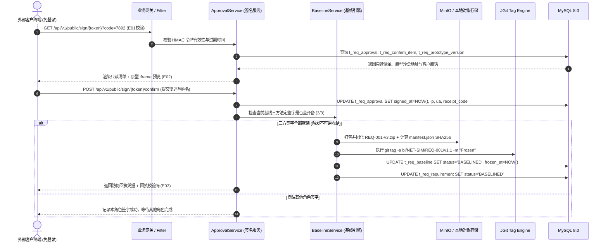
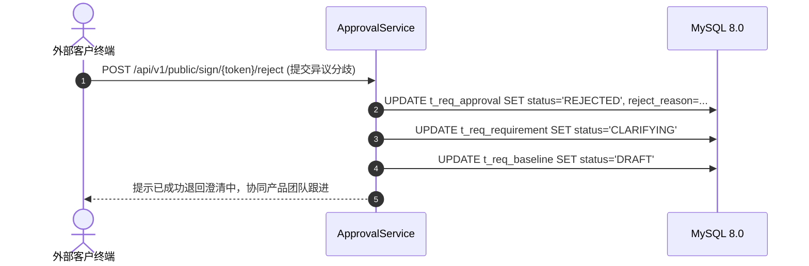

# 📐 详细技术设计说明书: 需求与版本全生命周期治理模块 (req-management)

> **归属模块**：`req-management` (业务核心域)  
> **设计模式**：模式 A (只写模块施工图，不动全局底层内核)  
> **前置契约源**：[prd-req-management-v1.0.md](../../modules/req-management/prd-req-management-v1.0.md) ｜ [mockup.html](../../modules/req-management/mockup.html)  
> **遵循规范**：钧天科技《02-sop-tech-design.md》必含 5 节硬标准与看门狗契约冻结。

---

## 1. 版本变更历史

| 版本号 | 日期 | 变更责任人 | 关联看板 Task | 关键决策与变更摘要 |
| :--- | :--- | :--- | :--- | :--- |
| `v1.0.0` | 2026-10-29 | 架构团队 | `[Task-500]` | 首次冻结设计：落地 6 张物理表、RESTful 契约、SHA256 快照与客户免登签名引擎 |

---

## 2. 端到端核心时序流 (Mermaid Sequence)

### 2.1 客户免登录签名确认与基线物理冻结时序流


### 2.2 客户逆向驳回分歧流转


---

## 3. 接口契约冻结 (RESTful API Specifications)

### 3.1 接口清单概览
| 接口方法 | 路径 | 权限认证 | 核心业务行为 |
| :--- | :--- | :---: | :--- |
| `POST` | `/api/v1/req/requirements` | 内部登录 | 快速录入需求（存客户原话、责任人） |
| `PUT` | `/api/v1/req/requirements/{id}/confirm-items` | 内部登录 | 批量保存四层清单决策与代价人天 |
| `POST` | `/api/v1/req/prototypes/upload` | 内部登录 | 上传原型 ZIP 包，计算整体 SHA256 并生成 `v(N+1)` |
| `POST` | `/api/v1/req/baselines` | 内部登录 | 申请创建新基线并生成三方客户签名专用链接 |
| `GET` | `/api/v1/public/sign/{token}` | 免登录 (Code保护) | 客户凭 Token 和 4 位访问码拉取只读确认上下文 |
| `POST` | `/api/v1/public/sign/{token}/confirm` | 免登录 (Code保护) | 客户提交一句话复述与电子签署 |
| `POST` | `/api/v1/public/sign/{token}/reject` | 免登录 (Code保护) | 客户提出异议分歧并驳回至澄清态 |
| `GET` | `/api/v1/req/baselines/{id}/diff` | 内部登录 | 智能计算当前基线与上一基线的增量差分 |

---

### 3.2 核心接口契约 Schema 详情

#### ① 客户免登签署确认：`POST /api/v1/public/sign/{token}/confirm`
* **Request Header**：`Content-Type: application/json`
* **Path Variable**：`token` (String, 64位加密随机串)
* **Request Body**：
```json
{
  "access_code": "7892",
  "signer_name": "王工",
  "restatement_text": "这版做在线状态和告警，不做历史曲线和导出，符合预期。",
  "agree_disclaimer": true
}
```
* **Response Body** (`200 OK`，契约冻结)：
```json
{
  "code": 200,
  "msg": "签署成功",
  "data": {
    "receipt_code": "7F3A-91C2-88B1",
    "baseline_version": "BL-v1.1",
    "is_fully_frozen": true,
    "manifest_hash": "a3f9c2e177b9d40e1189ac3bb4109401bfd145cba2793108c40b7190e82c7a10",
    "signed_at": "2026-11-02T15:02:11"
  }
}
```

#### ② 基线差异智能对比：`GET /api/v1/req/baselines/{id}/diff?target_id=xxx`
* **Response Body** (`200 OK`，契约冻结)：
```json
{
  "code": 200,
  "data": {
    "source_version": "BL-v1.0",
    "target_version": "BL-v1.1",
    "net_cost_growth": 0.5,
    "item_diffs": [
      {
        "type": "ADDED",
        "item_code": "E-03",
        "question": "数据延迟报警提示",
        "old_decision": "NONE",
        "new_decision": "CURRENT",
        "cost_delta": 0.5
      },
      {
        "type": "MODIFIED",
        "item_code": "B-01",
        "question": "心跳掉线判定阈值",
        "old_decision": "120秒",
        "new_decision": "60秒",
        "cost_delta": 0.0
      }
    ],
    "prototype_diff": {
      "old_version": "v2",
      "old_hash": "7c1e8432a901f...",
      "new_version": "v3",
      "new_hash": "a3f9c2e177b9d..."
    }
  }
}
```

#### ③ 全局业务错误码（冻结）
| 错误码 Code | 业务含义 | 触发场景与处理策略 |
| :--- | :--- | :--- |
| `400101` | 签名链接已失效或过期 | Token 超过 7 天有效期，提示联系产品经理重新生成 |
| `400102` | 访问验证码错误 | 客户输入的 4 位防窥验证码不匹配，连续 5 次错误锁定 |
| `400201` | 基线冻结门禁未放行 | “本期不做”未满 3 条或清单四层不全，前端置灰并拦截 |
| `400202` | 原型包静态相对路径异常 | 上传 ZIP 包根目录缺失 `mockup.html` 或含外网 CDN 强依赖 |
| `400301` | 已冻结基线禁止物理修改 | 任何试图 UPDATE 已冻结基线与清单的请求直接拒绝 |

---

## 4. 数据模型设计 (Data Model)

物理数据表结构已完成规范化建模，严格遵循 InnoDB、utf8mb4、snake_case 命名规约，包含主键、唯一键与常用查询组合索引：
1. `t_req_project`：项目代号与空间隔离（`uk_req_proj_key`）；
2. `t_req_requirement`：需求定义与客户原话长文本（`uk_req_code` 联合唯一）；
3. `t_req_confirm_item`：范围/规则/异常/验收/不做清单项及代价 JSON（`uk_req_item_code`）；
4. `t_req_prototype_version`：解压目录与全目录整体 `SHA256` 快照（`uk_proto_ver`）；
5. `t_req_baseline`：不可篡改 Git Tag 与 manifest 存储哈希（`uk_base_ver`）；
6. `t_req_approval`：三方法定签名留痕（IP、UA、复述、回执校验码、驳回原因，`uk_appr_token`）；
7. `t_req_artifact`：设计文档与归档 Zip 产物挂载表（`idx_art_hash`）。

---

## 5. 数据库脚本归宿 (SQL Schemas)

- **全量物理表脚本**：[`docs/db/service.sql`](../../db/service.sql)（第 4 章节：已完整包含 `t_req_project` ~ `t_req_artifact` 7 张核心业务表与索引约束，开箱即用）。
