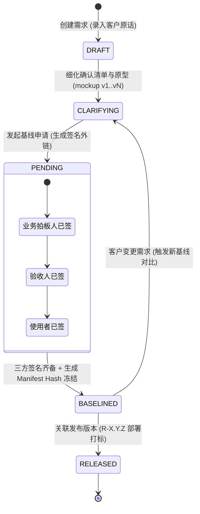
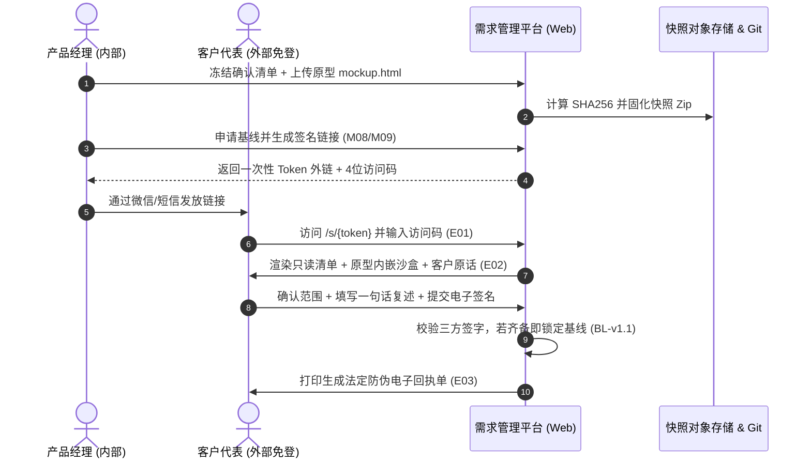

# 📦 业务模块 PRD: 需求与版本全生命周期治理模块 (v1.0)

> **归属模块**：`req-management` (需求与版本管理平台核心域)  
> **单一事实源绑定原型**：[`docs/modules/req-management/mockup.html`](mockup.html)  
> **依据规范**：遵循钧天科技架构规范、`01-sop-planning.md` 需求规划及 `archetype-architect` 标准。

---

## 📌 1. 模块定位与核心价值

- **核心一句话**：管住 **需求 · 版本 · 原型** 三件事，做到 **留痕、可确认、可追溯**。
- **业务边界锁定**：
  - ✅ **系统必管**：项目空间、客户原话留痕、四层确认清单（含代价折算）、原型版本快照托管（SHA256）、不可变需求基线（Git Tag+Manifest）、免登录客户外部签名（E01~E03）、发布版本绑定与全局码表外观。
  - ❌ **系统不管**：开发分支级任务派工、底层代码审查流水线、测试用例具体执行细节、在线拖拽甘特图。

---

## 📋 2. 交互组件矩阵 (基于确定性 DOM 探针抽取)

| 交互元素 / 模块 ID | 触发动作 | 前端交互行为 | 契约与后端状态变动 |
| :--- | :--- | :--- | :--- |
| `btnModeInternal` / `btnModeClient` | 点击切换 | 内部管理端 (P01~P18) 与外部免登录客户签名端 (E01~E03) 实时视窗切换 | 前端视图路由切换，免登录视窗模拟带入 Token 与 AccessCode |
| `[drawerChecklist]` (P06) | 打开抽屉 | 展示范围/规则/异常/验收/不做五类清单，支持三档决定单选切换 | 实时触发 `cost-summary-bar` 人天代价重新计算 |
| `decision-btn` (本期/下期/不做) | 点击单选 | 动态更新按钮高亮态 (`active-current` / `active-next` / `active-skip`) | 实时折算总代价并联动至外部客户确认页 (`#clientTotalCost`) |
| `[modalUploadPrototype]` (M05) | 文件提交 | 接收包含 `mockup.html` 的 Zip 包，禁止覆盖旧版 | 后端计算整体目录 `SHA256` 生成 `v(N+1)` 快照，写入清单 L3 |
| `[drawerNewBaseline]` (M08) | 提交冻结 | 校验关联原型、文档与三方法定签字人 | 状态置为 `PENDING`，触发生成客户一次性签名链接与访问码 (M09) |
| `[signer3Name]` + `handleClientSign()` | 点击签署 | 校验姓名与一句话复述，若三人已全签自动触发防伪凭证 | 基线状态流转为 `BASELINED` (不可变)，生成电子回执 E03 (L6 锁定) |
| `[page-baseline-diff]` (P12) | 页面加载 | 对比 `BL-v1.0` 与 `BL-v1.1` 的清单/原型/文档差分 | 输出增量人天代价（+0.5d）与原型快照 Hash 变化列表 |
| `[page-timeline]` (P13) | 页面点击与节点下钻 | 横向多泳道渲染需求演进里程碑 (原型 ➔ 基线 ➔ 计划发布) | 点击基线/发布节点直接联动下钻对应详情、差异与审计证据 |

---

## 📊 3. 场景化 Mermaid 架构图表

### 3.1 核心状态流转状态机 (State Machine)

### 3.2 客户免登录签名确认端到端时序图 (Sequence Diagram)

---

## 🧠 4. 状态共享与依赖矩阵 (Dependency Grid)

1. **全局状态与存储 (Local Store / Cache)**：
   - `active_project`: 当前选中项目上下文（默认 `NET-SIM`）。
   - `active_perspective`: 当前视图形态（`internal` 内部端 / `client` 外部客户免登录端）。
   - `prototype_manifest`: 原型快照索引表，强制要求每个版本记录拥有唯一的 `SHA256` 校验和。
2. **持久化与安全凭证 (Storage & Security)**：
   - 客户外部签名链接采用一次性加密随机 Token（有效期 7 天），配合短信/邮件验证码二次核身，不走系统 Cookie/Session 登录鉴权。
   - 任何已冻结基线（`BASELINED`）对应的数据记录禁止 `UPDATE` 与 `DELETE`，只能通过新建增量基线进行差分追溯。

---

## 🚪 5. 原型验收与 Sign-off Checklist

- [x] 原型文件已独立落盘于 [mockup.html](mockup.html)
- [x] 完整复刻 21 个页面骨架与 15 个操作模块核心交互
- [x] 交互深度支持“三档决定”动态代价总计（+2.0d / +1.0d 联动）
- [x] 满足外部客户免登 E01~E03 签名视窗模拟
- [x] 视觉契约严格对齐工业主色 `#14535B` 与 WCAG 4.5:1 高对比度标准
