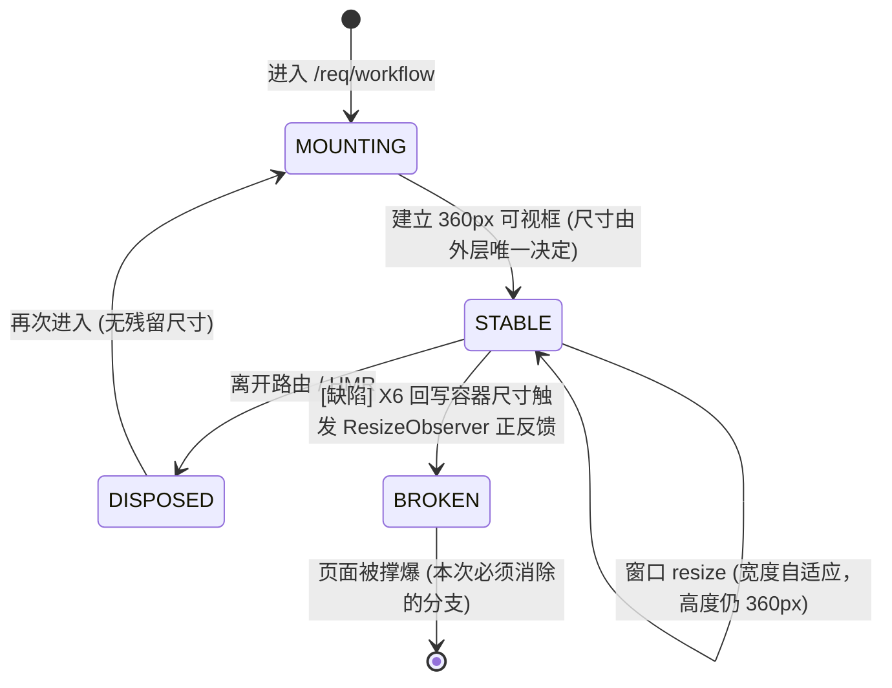
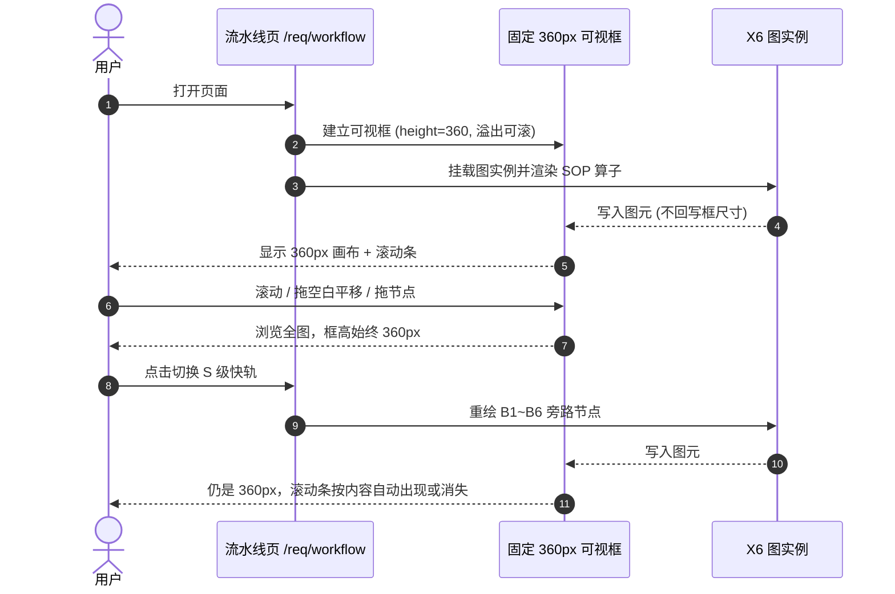

# 📦 业务模块 PRD: 工程流水线拓扑画布可视区治理 (v1.0)

> **归属模块**：`req-management` · 页面 `/req/workflow`（工程流水线 · 算子状态与责任人透视大屏）
> **需求 ID**：`FR-REQ-WFC-01`
> **单一事实源绑定原型**：[`mockup-workflow-canvas-viewport.html`](mockup-workflow-canvas-viewport.html)
> **配套规格 / 测试契约**：[`srs.md`](../../srs/workflow-canvas-viewport/srs.md) ｜ [`workflow-canvas-viewport-testcase.md`](../../test-cases/workflow-canvas-viewport-testcase.md)
> **依据规范**：`.ai/sop/01-sop-planning.md`（[1] 需求规划与任务拆解）
> **当前状态**：🟡 需求基线已收敛，等待原型 Sign-off → 进入 `[2]` 技术方案

---

## 📌 0. 需求基线总结（8 维扫描 · 四态标注）

> 四态口径：`已确认` 用户明确拍板 ｜ `AI推断` 由实测证据推导 ｜ `暂定` 给推荐默认值、可一句话改 ｜ `待确认` 需用户补充事实。

| 维度 | 白话场景 | 基线结论 | 状态 |
| :--- | :--- | :--- | :--- |
| **正常** | 打开流水线页，看 L 级 11 个算子 / S 级旁路矩阵 | 画布可视区**恒为 360px**；看不全的部分靠滚动条查看；平移、节点拖拽、Ctrl+滚轮缩放照旧可用 | `已确认` |
| **失败** | 页面放一会儿，画布越变越大、把整张卡片撑到十几万像素 | **容器尺寸只能由外层布局决定，X6 不得回写自身尺寸**；连续采样尺寸不增长 | `AI推断`（已实测复现） |
| **边界** | 窗口很矮 / 很窄、节点被拖到边界、内容本身不足 360px | 不出现双滚动条；内容不足 360px 时不出现滚动条；节点拖拽不越出内容边界 | `暂定` |
| **生命周期** | 首次挂载、L↔S 轨道切换重绘、路由离开再回来、窗口 resize、Vite HMR | 每次重绘后高度仍恒 360px；离开页面时清理监听，不残留旧尺寸 | `暂定` |
| **上下游** | 上方步进器、下方「B1~B6 旁路矩阵」面板、全屏布局 | **本次不改全屏布局**；下方面板不再被画布撑到看不见的位置 | `已确认` |
| **规模** | L 级 SOP-00~09 + 3 大区；S 级 B1~B6 全套节点 | 滚动到尽头能看到全部节点；不因固定高度引入渲染性能退化 | `AI推断` |
| **误操作** | 在画布空白处拖一下、Ctrl+滚轮缩放、点着节点拖出边界 | 平移手势不牵动原生滚动条；缩放不改变容器像素尺寸；节点拖出边界被约束 | `暂定` |
| **重启恢复** | 刷新页面 / 热更新后 | 不复发膨胀，不保留上一次的异常尺寸 | `暂定` |

**三项用户拍板的取舍（已确认，不得在 `[2]` 擅自改写）**

1. 可视高度 **固定 360px**（不选跟随窗口自适应）。
2. 超出部分使用 **滚动条 + 保留画布平移**（平移与节点拖拽都保留，二者互不干扰）。
3. 改动范围 **只修画布区域**，不顺带放开全屏路由的 `overflow:hidden`。

**实测证据（2026-11-06，Vite dev server `localhost:3000`，视口 1080×577）**

| 采样时刻 | `.x6-graph` 尺寸 | 外层卡片尺寸 |
| :--- | :--- | :--- |
| T0 | 49889 × 110470 px | 49923 × 110546 px |
| T+2s | 51045 × 113054 px | 51079 × 113130 px |

2 秒内宽 +1156px、高 +2584px，**尺寸持续增长**。X6 把自身 `width/height` 内联样式写回了挂载容器（容器原写 `height:210px` 被覆盖），`autoResize:true` 的 ResizeObserver 由此形成「容器变大 → 画布更大 → 容器再变大」正反馈；`.app-content.is-fullscreen` 的 `overflow:hidden` 让溢出内容既看不到也滚不动。

---

## 📌 1. 模块定位与核心价值

- **核心一句话**：让工程流水线拓扑图**老实待在 360px 高的框里**，看不全的部分用滚动条看，页面不再被撑爆。
- **业务边界锁定**：
  - ✅ **本次必管**：拓扑画布可视区尺寸、溢出可达性、平移/拖拽/缩放与滚动共存、L↔S 切换后的尺寸稳定性。
  - ❌ **本次不管**：全屏路由的整体滚动策略、旁路矩阵面板内容、算子数据来源（当前为前端硬编码）、节点业务属性、后端接口与数据库、X6 版本升级。

---

## 📌 2. PA 三层拆解

| 层级 | 内容 |
| :--- | :--- |
| **Epic** | 工程流水线透视大屏的可用性与尺寸稳定性治理 |
| **User Story** | 作为研发 / 产品经理，我希望打开流水线页时拓扑画布保持固定高度、看不全的节点能滚动查看，这样页面不会被无限撑大，也不必反复缩放去找节点 |
| **Use Cases** | `UC-01` 滚动查看完整拓扑 ｜ `UC-02` 平移画布 ｜ `UC-03` 拖拽单个节点排版 ｜ `UC-04` Ctrl+滚轮缩放 ｜ `UC-05` 切换 L/S 轨道重绘 ｜ `UC-06` 窗口尺寸变化后仍稳定 |

---

## 📌 3. 业务规则（每条都可验收）

| 规则 ID | 白话规则 | 验收断言 |
| :--- | :--- | :--- |
| `BR-01` | 画布可视区高度恒定 360px | 挂载后任意时刻 `getBoundingClientRect().height === 360`（允许 ±1px 边框误差） |
| `BR-02` | 图元变多变少、平移缩放拖拽，都不能改变可视区像素尺寸 | 连续 3 秒每 200ms 采样，宽高方差为 0 |
| `BR-03` | 内容超出 360px 时出现纵向滚动条，横向超出时出现横向滚动条 | `scrollHeight > clientHeight` 时 `overflow-y` 可滚动；滚动到底可见最下方节点 |
| `BR-04` | 内容不足 360px 时不出现多余滚动条 | `scrollHeight <= clientHeight` 时纵向滚动条消失 |
| `BR-05` | 画布平移保留，且拖空白不牵动原生滚动条 | 平移前后 `scrollTop/scrollLeft` 不变，容器内图元发生位移 |
| `BR-06` | 节点拖拽保留，且不能把节点拖出内容边界 | 节点坐标始终落在既有 `translating.restrict` 范围内 |
| `BR-07` | L↔S 轨道切换、路由往返、HMR 后高度仍是 360px | 每类操作后重测 `BR-01` 均通过 |
| `BR-08` | 只改画布区域 | diff 中不得出现 `Layout.vue` 全屏布局样式与旁路矩阵面板结构改动 |

---

## 📌 4. 交互组件矩阵

| 交互元素 / 模块 ID | 触发动作 | 前端交互行为 | 尺寸不变式 |
| :--- | :--- | :--- | :--- |
| `viewport-workflow-canvas` | 页面加载 / 轨道切换 | 固定 360px 可视框，内部承载 X6 图元，超出可滚 | 宽高恒定 |
| `scrollbar-x` / `scrollbar-y` | 鼠标滚轮 / 拖动滚动条 | 在可视框内浏览图元，不推动外层卡片 | 外层卡片高度不随滚动变化 |
| `pan-workflow-canvas` | 左键拖动画布空白处 | 平移图元视口 | `scrollTop/scrollLeft` 不变 |
| `node-drag` | 左键拖节点 | 节点重排版，受既有边界约束 | 可视框尺寸不变 |
| `zoom-ctrl-wheel` | Ctrl / ⌘ + 滚轮 | 缩放图元 | 可视框尺寸不变 |
| `btnTrackStandard` / `btnTrackFasttrack` | 点击切换 L / S 轨道 | `clearCells` 后重绘两套拓扑 | 重绘后仍 360px |

---

## 📌 5. 场景化 Mermaid

### 5.1 画布尺寸生命周期状态机

### 5.2 打开页面到可交互的时序

---

## 📌 6. 原型验收 Sign-off

原型：[`mockup-workflow-canvas-viewport.html`](mockup-workflow-canvas-viewport.html)（零依赖，浏览器直接打开）

- [ ] 可视框高度读数恒为 360px，切换 L/S 轨道后不变
- [ ] 内部大画布超出时可用纵向 / 横向滚动条看全节点
- [ ] 「模拟平移」开关打开后拖空白可平移图元，滚动条位置不被牵动
- [ ] 对照面板能看到「修复前尺寸持续膨胀」与「修复后恒定」的差异
- [ ] 下方面板位置不被画布撑走

> ⚠️ 原型 Sign-off 由用户本人完成；`[7]` 终验同样必须用户显式放行。

---

## 📌 7. 范围红线（不做清单）

1. 不改 `Layout.vue` 的全屏 `overflow:hidden`，不放开整页滚动。
2. 不改「B1~B6 研发旁路与自愈矩阵」等下方面板的内容与结构。
3. 不改算子数据来源，不引入新依赖、不升级 X6、不新增后端接口。
4. 具体技术手段（是否引入 scroller 插件、是否关 `autoResize`、是否加 wrapper 层）**留到 `[2]` 技术方案决定**，本阶段只锁定行为规格。

---

## 📌 8. 后续 B2 快修演进与范围红线调整（2026-11-06）

### 8.1 用户授权的口径变化

| 原基线 | 调整后 | 授权来源 |
| :--- | :--- | :--- |
| 可视区 360px + 超出用滚动条 | 360px 高度**保留**；改为「节点按宽度自适应折行铺满」，正常情况下不出现滚动条 | 16:07 用户选「保持字号，节点改排两行铺满」 |
| `BR-03` 内容超出用滚动条 | 折行后内容不再超出；`overflow:auto` 作为兜底保留 | 同上 |
| 只修画布区域、不改下方面板结构 | 需求列表从左侧 320px 列移至画布下方（**位置**调整，内容与字段未改） | 15:59 用户选「画布独占整行，列表移下方」 |
| 原 4 个大区分组框 | 折行布局下不再绘制，节点颜色仍区分阶段 | 16:07 方案已知副作用，已在当轮回复中告知 |

### 8.2 仍然有效的红线

1. 未改 `Layout.vue` 全屏 `overflow:hidden`，未放开整页滚动。
2. 未改算子数据来源（仍为前端硬编码），未引入新依赖、未升级 X6、未新增后端接口。
3. `autoResize:false`、两层 DOM、`WORKFLOW_CANVAS={1450,520}` 作为 X6 逻辑画布尺寸、`translating.restrict` 均未变。
4. `[7]` 终验仍需用户本人显式放行，AI 不得自行 `complete --accept`。

### 8.3 验收证据清单

| 轮次 | 截图 | 关键读数 |
| :--- | :--- | :--- |
| ① 右侧裁切修复 | `workflow-canvas-rightside-verified.png` | 右列 1497→657，滚到底可见「里程碑交付发布区」 |
| ② 铺满整行 | `workflow-canvas-fullwidth-verified.png` | 1280 画布卡片 623→997；1920 达 1637 |
| ③ 折行自适应 | `workflow-canvas-autolayout-verified.png` | 1280 两行 x 51→901；1920 一行 x 39→1566 |
| ④ 首屏收敛 | `workflow-canvas-init-verified.png` | 首屏 T+0.4s 即两行 x 31→927，与点击后完全一致 |

> 截图位于 `docs/modules/req-management/`。施工图 §7 记录实现细节，SRS §10 记录补充规格，TC §5 记录补充用例，探针 `C-09~C-12` 做静态回归。
