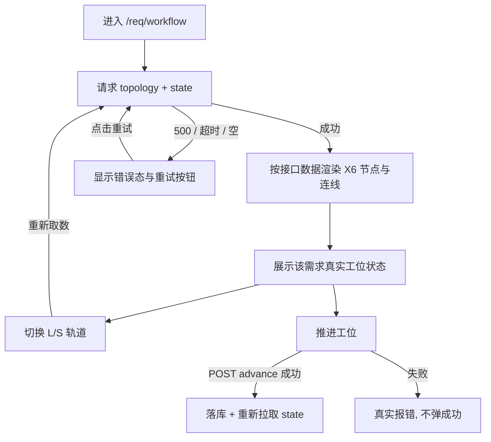

# 📦 业务模块 PRD: 工程流水线拓扑数据驱动改造 (v1.0)

> **归属模块**：`req-management` · 页面 `/req/workflow`
> **需求 ID**：`FR-REQ-WFC-02` ｜ **上游需求**：`FR-REQ-WFC-01`（画布可视区治理，Task-510 仍 ACTIVE）
> **参考基准**：[`WORKFLOW_GUIDE.md`](../../../../WORKFLOW_GUIDE.md) §2「0~13 数字 SOP 开发全流程」、§8「SOP 与 Skill 绑定映射全景表」、§9「SOP 阶段索引」
> **单一事实源**：`.cursorrules §1` + `.ai/sop/*.md`（共 16 篇）
> **原型**：[`mockup-workflow-sop-data-driven.html`](mockup-workflow-sop-data-driven.html)
> **规格 / 测试**：[`srs.md`](../../srs/workflow-sop-data-driven/srs.md) ｜ [`workflow-sop-data-driven-testcase.md`](../../test-cases/workflow-sop-data-driven-testcase.md)
> **状态**：🟡 `[1]` 需求基线已收敛 → 待 `[2]` 技术方案冻结表结构与接口字段

---

## 📌 0. 需求基线总结（8 维扫描 · 四态标注）

> 四态：`已确认` 用户拍板 ｜ `AI推断` 由现状证据推导 ｜ `暂定` 推荐默认值、可一句话改 ｜ `待确认` 需用户补事实。

| 维度 | 白话场景 | 基线结论 | 状态 |
| :--- | :--- | :--- | :--- |
| **正常** | 打开流水线页、切 L/S 轨道、切不同需求 | 节点、连线、大区、文案、Skill、产物、工位状态**全部来自接口**；前端不保留任何节点字面量 | `已确认` |
| **失败** | 接口 500 / 超时 / 返回空 | **显式错误态 + 重试入口**；禁止静默降级到硬编码、禁止「失败也报成功」 | `AI推断`（由既有缺陷推导，见 §1） |
| **边界** | 新需求首次访问、库里没有它的状态、某轨道暂无连线 | 首次按流程定义初始化该需求状态（首节点 IN_PROGRESS、其余 PENDING）；定义表为空时报错而非画空图 | `暂定` |
| **生命周期** | 改了 `.ai/sop/*.md`、刷新页面、推进工位、切需求、后端重启 | 定义可从 SOP 文件同步且不留第二份手抄；推进后状态落库、刷新仍在；不同需求状态互不串 | `AI推断` |
| **上下游** | 旧 `.ai/dag_state.json`、`WorkflowController`、前端 `pipelineNodes` | 停用本地 JSON 读写；`current_node`/`activeNode` 字段统一；前端删除 `pipelineNodes`/`fasttrackNodes` 数组 | `已确认` |
| **规模** | 16 篇 SOP + 约 20 条连线 + N 个需求实例 | 一次接口返回整套拓扑（不做 N+1）；状态按 `(reqCode, track, stage)` 隔离 | `暂定` |
| **误操作** | 连点推进、失败后重试点、切轨道时状态串轨 | 状态键唯一；失败不发成功提示；轨道切换只取对应轨道的定义与状态 | `AI推断` |
| **重启恢复** | 后端重启 / 页面刷新 / Task-510 的 360px 画布契约 | 状态从库恢复，不依赖本地文件；**可视框 360px、两层 DOM、`autoResize:false` 保持不变** | `已确认`（向后兼容） |

**用户拍板的三项取舍（已确认，不得在 `[2]` 改写）**

1. **流程定义 + 工位状态都入库**：新建 SOP 节点/连线表并初始化 16 篇，每个需求的工位进度也存 MySQL；页面全量由接口驱动。
2. **口径以现行 16 篇为准**：节点 ID 用 `.cursorrules §1` 的 `[0]~[9]` + `[B1]~[B6]`；`WORKFLOW_GUIDE.md` 只提供 Skill 绑定、输出产物、职责与门禁文案。
3. **保留 L/S 双轨**：标准主链 / 极速快轨两套视图不变，但两套的节点、连线、文案、状态都由接口给。

**参考指南的具体用法（避免把旧编号当成事实源）**

| 指南位置 | 本次取用什么 | 不取用什么 |
| :--- | :--- | :--- |
| §2 Mermaid | 主链 / 交付链 / 旁路三轨道的分组语义、阶段顺序 | `0~13` 这个数字口径本身 |
| §8 全景表（16 行） | 每阶段的**职责描述、绑定 Skill、输出产物、门禁说明**，作为节点详情字段的内容来源 | N00~N13 的旧编号、旧指令别名（`[1+]`、旧 `2`=编码 等） |
| §9 索引表 | 「由 `sync_tree.py` 从 `.ai/sop/*.md` 实时生成、禁止手抄第二份」这条治理原则 | 表内文本本身（它是派生视图） |

> ⚠️ 指南 §8 的 N00~N13 是旧口径：N2 标「`[3]` 单焦点编码」、N10 标「`[2]` 技术方案」，与现行 `.cursorrules §1` 冲突。本需求一律以现行 16 篇为准，指南仅作内容字典。

---

## 📌 1. 现状与本次要一并修掉的缺陷

| # | 现状 | 证据 | 本需求处理 |
| :--- | :--- | :--- | :--- |
| 1 | 拓扑节点/坐标/连线/文案/status 全前端写死 | `ReqManagementView.vue:86-109` 两个数组、`:180+` `renderWorkflowGraphData()` | 全部改由接口数据渲染，删除数组字面量 |
| 2 | 节点状态按 `req.status` 在浏览器里本地推测 | `:493-524` `handleSelectWorkflowReq()` | 改为读取该需求的真实工位状态 |
| 3 | DAG 状态不进数据库，读写 `.ai/*.json` 文件 | `WorkflowController.java` 用 `ObjectMapper` 读写 `.ai/dags/dag_<code>.json` | 状态迁入库；停用文件读写 |
| 4 | 字段错位：后端 `current_node` / 前端 `activeNode` | `WorkflowController.java:69` vs `ReqManagementView.vue:465` | 统一字段；接口契约在 `[2]` 冻结 |
| 5 | 接口失败也弹「已确认」成功提示 | `ReqManagementView.vue:488` | 改为真实报错 + 重试，禁止假成功 |
| 6 | 兜底假值：`ownerName \|\| '张工'`、`updatedAt \|\| '2026-10-29'`、`reqCode \|\| 'REQ-001'` | `:1323-1326`、`:461`、`:479` | 缺失字段显示占位符或报错，不写死人名/日期 |

**数据库现状**：`docs/db/service.sql` 只有 8 张 `t_req_*` 表，**没有任何流程定义或工位状态表**；`docs/db/migrations/` 目录尚不存在 → 本需求必须补 Migration 与 rollback 配对（SOP `[2]` 硬要求）。

---

## 📌 2. 模块定位与业务边界

- **一句话**：把流水线大屏从「前端写死的演示稿」升级成「数据库驱动、每个需求有独立真实进度的状态机」。
- ✅ **本次必管**：流程定义（节点/连线/大区/文案/Skill/产物）、每需求的工位状态、L/S 双轨、接口失败与空态、SOP 定义同步、`[1]` 列出的 6 个缺陷。
- ❌ **本次不管**：节点下钻详情面板、合并成单张全流程大图、改 `.ai/sop/*.md` 正文、改看板 `board.py` 状态机语义、放开全屏路由 `overflow:hidden`、改 Task-510 的 360px 画布契约。

---

## 📌 3. PA 三层拆解

| 层级 | 内容 |
| :--- | :--- |
| **Epic** | 工程流水线透视大屏的数据驱动化与真实状态机落地 |
| **User Story** | 作为研发 / 产品经理，我希望改流程时只改 SOP 定义而不用改前端代码，且每个需求的工位进度能真实存下来、刷新不丢，这样大屏展示的就是实际进展而不是写死的示意图 |
| **Use Cases** | `UC-01` 查看双轨拓扑 ｜ `UC-02` 切换需求看各自进度 ｜ `UC-03` 推进工位并持久化 ｜ `UC-04` 从 SOP 文件同步流程定义 ｜ `UC-05` 接口失败看到错误并重试 ｜ `UC-06` 沿用 360px 画布的滚动 / 平移 / 拖拽 |

---

## 📌 4. 业务规则（每条可验收）

| 规则 ID | 白话规则 | 验收断言 |
| :--- | :--- | :--- |
| `BR-01` | 前端零硬编码节点 | 源码中不再存在 `pipelineNodes` / `fasttrackNodes` 数组，也无 `createGraphNode('SOP-..')` 字面量调用 |
| `BR-02` | 节点 ID 只用现行 16 篇编号 | 接口返回的 `stageCode` 集合等于 `[0]~[9]` + `[B1]~[B6]`，不含 `LM-xx` / `GATE-xx` / `TC-GEN` / `SIGN-OFF` 等编造节点 |
| `BR-03` | 文案来自指南 §8 字典 | 节点的职责 / Skill / 产物 / 门禁字段可在指南 §8 全景表逐行对照 |
| `BR-04` | 双轨保留且都动态 | `track=STANDARD` 与 `track=FASTTRACK` 各返回一套节点与连线；切换不残留上一轨内容 |
| `BR-05` | 状态按需求隔离并落库 | 同一节点在 `REQ-001` 与 `REQ-002` 下可有不同状态；推进后刷新页面状态不变 |
| `BR-06` | 失败必须真实暴露 | 接口 500 / 超时 / 空数据时，页面显示错误态与重试按钮，**不出现任何节点、不弹成功提示** |
| `BR-07` | 定义可从 SOP 同步，不留第二份手抄 | 同步后库中定义与 `.ai/sop/*.md` 的 16 篇标题 / 触发词 / 产出一致；新增一篇 SOP 后同步可自动出现 |
| `BR-08` | 消灭字段错位与兜底假值 | 前端不再出现 `activeNode` 读取、不再出现 `\|\| '张工'` / `\|\| '2026-10-29'` / `\|\| 'REQ-001'` |
| `BR-09` | 向后兼容 Task-510 | 可视框仍 360px、`autoResize:false`、两层 DOM；`test_workflow_canvas_viewport.py` 8 条探针保持全绿 |
| `BR-10` | 建表必须有回滚 | `docs/db/migrations/` 下存在 `V*.sql` 与同版本 `rollback_V*.sql` 且非空 |

---

## 📌 5. 数据实体与接口清单（需求级，字段由 `[2]` 冻结）

> 本节只描述「需要哪些东西」，不冻结字段名、类型与索引 —— 那是 `[2]` 施工图的职责（SOP `[1]` 硬约束：需求未稳定前不进入技术选型）。

| 概念实体 | 装什么 | 来源 |
| :--- | :--- | :--- |
| **SOP 节点定义** | 阶段编号、所属轨道、标题、职责描述、绑定 Skill、输出产物、门禁、责任角色、画布坐标、大区分组、排序、启用态 | `.ai/sop/*.md` 的标题/触发/产出 + 指南 §8 全景表 |
| **SOP 连线定义** | 起点、终点、轨道、线型、颜色、标签 | 指南 §2 Mermaid 的阶段流转 |
| **工位状态实例** | 需求编号、轨道、阶段、状态、操作人、更新时间 | 用户推进 / 初始化 |
| **流程当前焦点** | 需求编号、轨道、当前阶段、模式 | 由状态实例派生或独立保存（`[2]` 定） |

| 接口（需求级） | 用途 |
| :--- | :--- |
| `GET /req/workflow/topology?track=...` | 一次返回该轨道的节点 + 连线 + 大区 + 文案 |
| `GET /req/workflow/state?reqCode=...&track=...` | 返回该需求在该轨道下每个阶段的状态与当前焦点 |
| `POST /req/workflow/advance` | 推进工位，真实落库；失败返回错误码 |
| `POST /req/workflow/sync-from-sop` | 从 `.ai/sop/*.md` 重新同步流程定义（可选，`[2]` 定是否纳入首版） |

---

## 📌 6. 交互流程（Mermaid）

### 6.1 加载与失败分支



### 6.2 数据流转时序

```mermaid
sequenceDiagram
    autonumber
    actor U as 用户
    participant V as /req/workflow 前端
    participant C as WorkflowController
    participant D as MySQL 流程定义/状态表
    participant S as .ai/sop/*.md

    S -->|sync-from-sop 同步 16 篇| D
    U->>V: 打开页面 / 切换轨道 / 切换需求
    V->>C: GET topology + state(reqCode, track)
    C->>D: 查询定义与实例状态
    D-->>C: 节点/连线/状态
    C-->>V: 统一契约响应
    V->>V: 渲染 X6 拓扑 (无任何本地节点字面量)
    U->>C: POST advance(reqCode, stage, status)
    C->>D: 落库工位状态
    C-->>V: 成功 / 明确错误码
    V-->>U: 刷新状态 / 显示错误与重试
```

---

## 📌 7. 原型验收 Sign-off

原型：[`mockup-workflow-sop-data-driven.html`](mockup-workflow-sop-data-driven.html)（零依赖）

- [ ] 页面节点完全由「接口响应样例 JSON」渲染，改 JSON 内容页面即变
- [ ] L 级（0~9 主链）与 S 级（B1~B6 旁路）双轨切换，两套数据独立
- [ ] 切换需求时各节点状态随之变化，体现需求间隔离
- [ ] 「模拟接口失败」后只显示错误态与重试，**不出现任何兜底节点、不弹成功提示**
- [ ] 节点详情可读到 Skill 绑定与输出产物（来自指南 §8 字典）
- [ ] 画布仍是 360px 固定可视框 + 滚动条（兼容 Task-510）

> ⚠️ 原型内嵌的 JSON 是**接口响应样例，仅用于演示**；生产实现严禁内置兜底数据（项目铁律 3：禁假数据）。

---

## 📌 8. 范围红线

1. 不改 `.ai/sop/*.md` 正文，不改 `board.py` 状态机语义。
2. 不引入新前端依赖、不升级 X6、不改 360px 画布契约。
3. 具体表结构、字段、索引、Migration 版本、接口字段与错误码**全部留给 `[2]` 冻结**，本阶段不写 DDL。
4. `WORKFLOW_GUIDE.md` §8 的旧编号只作历史参考，不得写进新表。
5. 看板 `Task-510` 仍为 ACTIVE 且未验收；本需求只登记 TODO，不抢占焦点。
