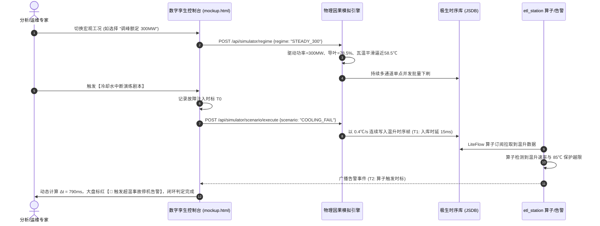

# 电站设备模拟器监控与分析校验控制台 需求 PRD

> **模块标识**: `simulator_console`  
> **版本号**: V2.0 (工业数字孪生与全厂物理因果耦合升级版)  
> **更新时间**: 2026-10-22  
> **交互原型**: [mockup.html](docs/modules/simulator_console/mockup.html)  

---

## 1. 业务目标与工业背景
在独立电站设备模拟服务（`station-device-simulator`）推流运行期间，为了使算法与分析人员能够直观**“看到”**当前发送给极生（JSDB）的时序真实波形，并与宿主数据分析平台（`etl_station`）的 LiteFlow 算子计算和告警结果进行**“同屏碰撞与评判比对”**，特规划本工业级数字孪生控制台。

本版本彻底摒弃孤立单点生成的玩具逻辑，引入**全厂物理机理、工况协同驱动、遥信遥测因果连锁与时标对齐评判闭环**。

---

## 2. 核心工业能力矩阵 (5 大改造落地)

| 能力维度 | 工业现状痛点 | 模拟器实现标准 |
| :--- | :--- | :--- |
| **1. 宏观工况协同牵引** | 单点参数各自孤立波动，缺乏机组整体工况概念。 | 提供 `[停机备用]`、`[空载并网]`、`[调峰稳态 300MW]`、`[满负荷 400MW]`、`[甩负荷解列]` 5 种工况，全机组点位联动变化。 |
| **2. 遥信与遥测因果链** | 断路器跳闸后负荷瓦温仍满载的“假电厂”逻辑。 | 断路器 QF01 变位为 0 瞬间，有功负荷断崖归零，导叶紧急关闭，瓦温转为大惯性自然降温。 |
| **3. 多通道叠图与偏瓦分析** | 单点孤立折线，无法诊断轴系平衡。 | 支持树形复选框多通道勾选，实现 1#瓦与 2#瓦同屏叠图，实时计算群瓦温差 ($\Delta T$)。 |
| **4. 真实事故演练剧本库** | 只有单一输入框突变越限。 | 内置 4 套典型剧本：冷却水中断（线性慢爬坡）、转子动静碰磨（高频混频）、调速器卡涩（低频振荡）、短路跳闸。 |
| **5. 算子响应时标闭环 (Benchmark)** | 无法科学衡量数据分析平台的漏报与响应时延。 | 记录故障注入时标 $T_0$、极生入库时标 $T_1$、算子告警触发 $T_2$，精准计算全链路时延 $\Delta t = T_2 - T_0$。 |

---

## 3. UI 交互时序 (Sequence Diagram)

