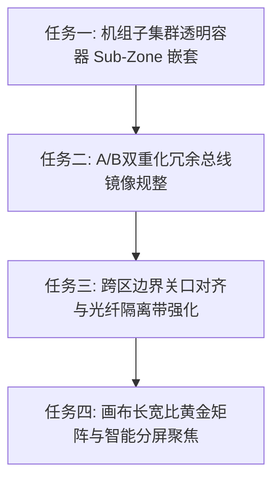

# 📌 归档：工业全景网络仿真与拓扑排版系统性优化实施计划

> 📦 本文件由 `.ai/tier3_status.md` 于 2026-10-28 迁移归档。
> 原因：该文件当时被误当作「规划文档」使用，而 `.ai/tier3_status.md` 的职责是**状态机看板**（仅供 board.py 读写）。
> 计划中的 4 项任务已拆分登记为看板 Task-401 ~ Task-404，本文件保留完整原始描述作为需求底稿。

# 🏭 工业全景网络仿真与拓扑排版系统性优化实施计划

根据对当前大型抽蓄/智能变电站导入呈现效果的深度评审，针对“大区内部挤公交、A/B冗余网交叉打架、跨区长线悬空、长宽比严重失衡”四大痛点，制定以下具备先后依赖的敏捷解决路线图。

---

## 🎯 任务全景路线图 (Roadmap)

---

### 📌 任务一：机组子集群透明容器（Sub-Zone 嵌套底板）
* **解决痛点**：OT 生产大区内 20+ 台设备混在一起，缺乏机组现地屏柜物理单元感。
* **实施方案**：
  1. 在 `unitMap`（1#~4#机组）计算出各机组独立包围盒后，自动为每个机组生成半透明轻量卡槽底板（例如：`1号机组LCU控制屏柜`、`2号机组控制单元`）；
  2. 底板使用虚线圆角框（`strokeDasharray: [4, 4]`），背景微透（`rgba(139, 92, 246, 0.05)`），顶部带小字标签；
  3. 将机组主 LCU 与下挂的调速器、励磁、球阀完全纳入子底板内部。
* **交付成效**：一眼识别 4 棵并列的机组独立工业单元，彻底告别“大通铺挤公交”。

---

### 📌 任务二：A/B 双重化冗余骨干总线（左右对称/上下双总线规整）
* **解决痛点**：A网交换机与B网交换机挤在一起横排，导致 A网与B网的下垂连线相互穿透交叉。
* **实施方案**：
  1. 识别具有 `A网/B网`、`主用/备用`、`双重化` 属性的核心交换/监控主机对；
  2. 采用标准电力二次自动化规范的**对称总线布局**：
     * **方案 A（左右镜像）**：A网系统居左侧，B网系统居右侧，中间留出双机热备心跳通道；
     * **方案 B（双母线错峰）**：A网为上总线，B网下移 20px 形成错峰下垂，双网连线各走专属端口通道，彻底杜绝空中十字交叉。
* **交付成效**：真正展现国家电网/南网高可靠性“双重化保护与容错”架构。

---

### 📌 任务三：跨区边界关口对齐与等保隔离光纤通道
* **解决痛点**：IT到DMZ再到OT的连线长达千像素，在空白区域硬拉一条悬空直线，毫无物理隔离与安全边界感。
* **实施方案**：
  1. **边界关口置边吸附**：将防火墙、单向网闸、纵向加密认证装置自动布局在大区的右边缘/左边缘边界线上；
  2. **隔离区安全走廊渲染**：在 IT ➔ DMZ ➔ OT 之间的大区空隙处，绘制专业工业“安全隔离带”背景网格与光纤干道标识；
  3. 跨区连线严格作为“安全通信摆渡通道”，赋予不同的光纤脉冲流光特效（例如纯激光单向传输）。
* **交付成效**：等保 2.0 工业安全隔离要求一目了然，极具专业演示与实战汇报说服力。

---

### 📌 任务四：画布长宽比黄金矩阵与智能分屏聚焦（避免压扁）
* **解决痛点**：全屏 `zoomToFit` 呈现出 5:1 的狭长扁条，字小看不清。
* **实施方案**：
  1. 优化大区排列结构，当检测到大区数量 ≥ 3 且单个大区特别宽时，支持**工业 16:9 矩阵自适应折行**（如上层 IT/DMZ 管理层，下层 OT 生产区全景横向铺开）；
  2. 实现“分区点击一键聚焦平滑缩放（Focus Zone）”，双击某个大区时平滑平移居中并放大至最佳阅读比例。
* **交付成效**：首屏加载比例饱满震撼，字体清晰可见，交互流畅灵动。