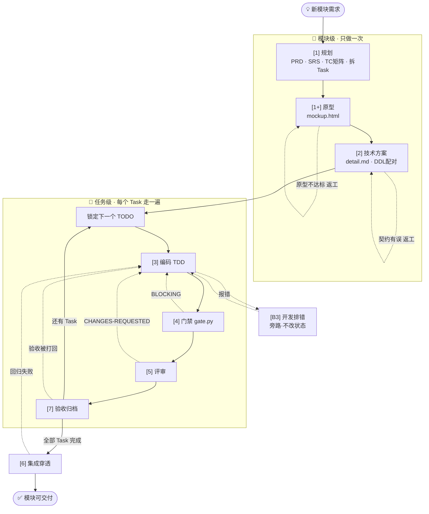
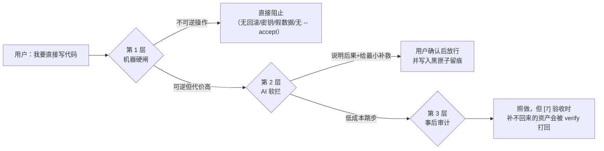

<!-- PANEL:START -->
## 0. 一句话概括

> **一个模块 = 1 次规划 + 1 次方案 + N 个 Task 的循环 + 1 次集成 + N 次验收。**
> 模块级节点只做一次；任务级节点每个 Task 走一遍。搞混这两层，就会出现"每个小改动都重写一遍 PRD"。

---

## 1. 全景图（含返工回路）



---

## 2. 节点清单：产出什么、**谁判定合格**、合格后去哪

> 这张表是核心。每一行都回答三件事：**产出什么 → 谁判合格 → 合格后走哪**。

| # | 节点 | 必产出的落盘物 | **谁判定合格** | ✅ 合格后 → | ❌ 不合格 → |
| :---: | :--- | :--- | :--- | :--- | :--- |
| 1 | `[1]` 规划 | `prd-<m>-v1.md`、`docs/01-requirements.md`、`srs.md`、`<m>-testcase.md`、看板 N 个 Task | **你**（业务对错）+ AI 自检完整性 | → `[1+]`（有界面）或 `[2]`（纯后端） | 留 `[1]` 补需求（见 §3.1） |
| 2 | `[1+]` 原型 | `mockup.html`（含空/加载/异常态） | **你**（照着点一遍） | → `[2]` | 留 `[1+]` 重做原型（见 §3.2） |
| 3 | `[2]` 方案 | `detail.md`（契约/表/时序）、`V*.sql`+`rollback_*.sql` | **你** 确认字段名 + `gate --sql` 机器校验 | → `[3]` | 留 `[2]` 改文档（见 §3.3） |
| 4 | `[3]` 编码 | `src/<m>/**` + 单测 | **`board verify`**（文件存在）+ TDD 三态 | → `[4]` | 留 `[3]`（见 §3.4） |
| 5 | `[4]` 门禁 | `gate.py` 报告 | **机器**：必须 `[LGTM]` | → `[5]` | 修 → 重跑 `[4]`（见 §3.5） |
| 6 | `[5]` 评审 | 评审报告 | **人**：`APPROVED` / `CHANGES-REQUESTED` | → `[6]` | 回 `[3]`（见 §3.6） |
| 7 | `[6]` 集成 | IT/E2E 报告 + 构建凭据 | **人**：TC P0/P1 全绿 + build 0 Error | → 该 Task 发 `[7]` | 回 `[3]`（见 §3.7） |
| 8 | `[7]` 验收 | 看板标绿 + 黑匣子 + `tier1` 刷新 + 模块登记 | **`board verify`** + **你点头** | → 下一个 Task，或 `[8]`/`[9]` | 回 `[3]`（见 §3.8） |
| 9 | `[8]`→`[9]` 交付 | 部署脚本、Tag、CHANGELOG | `bash -n` + Tag 存在 | 交付完成 / 下一个里程碑 | 回 `[3]` 修复后重发 |

> 🚨 **一条铁律**：**返工不改变状态机位置**——任务始终是 `ACTIVE`。
> 但**返工后必须沿原路重跑所有下游门禁**（因为代码/文档变了）。跳过重跑 = 假绿灯。

---

## 3. 不合格怎么办：8 个返工剧本（照抄即可）

### 3.1 PRD 漏了需求 / 业务规则理解错

```text
你：PRD 第 3 节漏了"一个用户可属于多个角色"，请补充，并同步补对应的测试用例。
```
- AI 应做：更新 `prd-<m>-v1.md` → 同步 `srs.md` → **补 `<m>-testcase.md` 用例**（这条最关键，漏了会出现"改了没测"）
- 返工后：确认 PRD 与用例都变了 → 再发 `[1+]` 或 `[2]`

### 3.2 原型不合格（你问的正是这个）

```text
你：原型第 2 页不对：①缺少"批量导入"按钮 ②异常态要有红色提示 ③移动端宽度下按钮会重叠。
   请只改这三处，其他别动，改完告诉我改了哪几处。
```

- AI 应做：**只改 `mockup.html`**，保持已确认的页面不动，输出"改动点清单"
- **判定合格的三条**：① 每个交互有入口 ② 空/加载/异常三态都有 ③ 你点一遍不迷路
- 返工后：**不跳节点**，仍在 `[1+]`；合格了才发 `[2]`
- ⚠️ 反模式：原型还没定就去写接口——后面必然返工

### 3.3 方案里字段名/表结构不对

```text
你：订单表不要叫 order，改叫 t_order；status 用 tinyint 不要 varchar。请改 detail.md 与迁移脚本，
   并确认 rollback 脚本同步改。
```

- AI 应做：**先改 `detail.md`（契约冻结，文档优先）** → 再改 `V*.sql` 与 `rollback_*.sql` → 跑 `gate --sql` 确认配对
- 返工后：`gate --sql` 绿 → 再发 `[3]`
- 🚨 如果已经写了代码才想起改契约：必须**先改文档再改代码**，顺序反了就会出现"代码与文档两张皮"

### 3.4 代码没实现要求 / 实现得不对

```text
你：分页没做，而且你把业务判断写进 Controller 了。请在 Service 里补分页，Controller 只做参数校验。
```
- AI 应做：改代码 + **补/改单测**（先红后绿）
- 返工后：`board verify` 通过 → 发 `[4]` 重新过门禁（**不能沿用上一次的 LGTM**）

### 3.5 门禁 BLOCKING

```text
你：修掉 gate 报的三个问题：假 Mock、硬编码密码、缺 rollback 脚本。修完重跑 gate。
```
| 报错 | 修法 |
| :--- | :--- |
| 疑似假 Mock | 删掉写死数据，让真实错误抛出来 |
| 新增依赖 | 删掉；确需则显式授权后加 `--large` 记录 |
| 硬编码密钥 | 挪到 `.env`，代码读环境变量 |
| 缺 rollback / 为空 | 在 `docs/db/migrations/` 补非空 `rollback_*.sql` |
| 空变更集 exit 2 | 先 `git add` 再看；**exit 2 不算通过** |

- 返工后：**重跑 `[4]` 直到 `[LGTM]`**，然后发 `[5]`

### 3.6 评审 CHANGES-REQUESTED

```text
你：按评审意见改：①事务范围太大 ②命名看不懂 ③没有异常日志。改完重新跑门禁再叫我评审。
```
- AI 应做：按"文件:行号"清单逐条改 → 重跑 `[4]` → 再走 `[5]`
- 🚨 **不许评审者自己顺手改代码**（身份混淆），改码一律回 `[3]`

### 3.7 集成失败

```text
你：集成时订单接口 500，日志显示 amount 字段类型不匹配。回 [3] 修，修完重跑门禁和集成。
```
- AI 应做：定位 → 改代码/改契约 → **重跑 `[4]` → `[6]`**
- 判断依据：真实报错日志，不是"再试一次好像好了"

### 3.8 验收被打回（你点了"不通过"）

```text
你：验收不通过：需求 ②没做到，并且文档没同步。先修，别标绿。
```
- AI 应做：**不调 `complete`**（任务仍是 ACTIVE）→ 回 `[3]` 修 → `[4]` → `[6]` → 重新 `verify`
- 只有 `verify` PASS + 你明确说"通过"才能 `complete --accept`

---

## 4. 返工的三条通用纪律

| 纪律 | 说明 |
| :--- | :--- |
| **定位到"产生缺陷的节点"** | 原型问题回 `[1+]`、契约问题回 `[2]`、代码问题回 `[3]`。**不要在下游节点打补丁** |
| **沿原路重跑下游门禁** | 改了代码就必须重跑 `[4]`；改了契约就必须重跑 `--sql`。旧凭证一律作废 |
| **返工不改状态机** | 任务始终 `ACTIVE`；只有 `[7]` 能标绿，返工期间**禁止** `complete` |

---

## 5. 三种规模的最短路径

| 规模 | 判定 | 路径 | 可省 |
| :---: | :--- | :--- | :--- |
| **S** | ≤2 文件、≤30 行、无 DDL/契约 | `[B2]` | 全部（不进状态机） |
| **M** | 单模块、无 DDL、不跨服务 | `[1]→[3]→[4]→[7]` | 原型、单独方案、评审、全量集成 |
| **L** | 跨服务 / 新服务 / 结构性 DDL | `[1]→[1+]→[2]→[3]→[4]→[5]→[6]→[7]` | 一个都不许砍 |

---

## 6. 开新模块的一页 Checklist

```text
□ 1. 发 [1]，一句话说清"谁在什么场景下要做什么"
□ 2. AI 问的选择题不会答 → "给推荐默认值，标暂定"
□ 3. 看 PRD：业务规则对不对？（不对现在就改，最便宜）
□ 4. 确认 TC 矩阵已落盘 docs/test-cases/<m>-testcase.md
□ 5. 有界面发 [1+]；拿着原型点一遍，三态齐不齐？
□ 6. 发 [2]，确认字段名/表结构 —— 之后改必须先改文档
□ 7. 发 [3]，每个 Task 一轮，看它改了哪些文件
□ 8. 发 [4]，只认 [LGTM]；BLOCKING 修完重跑
□ 9. 发 [5]（L 级必做），要"文件:行号"级问题清单
□ 10. 全部 Task 完成后发 [6]，确认真实数据不是 Mock
□ 11. 逐个 Task 发 [7]：verify 通过 + 你放行 → complete --accept
□ 12. 里程碑发 [8]/[9]，Tag 与回滚脚本必须配对
```

---

## 7. 三个最容易踩的坑

1. **把模块级节点当任务级做**：每个 Task 都重写 PRD → 文档爆炸、上下文被同一份 PRD 占满。
2. **把旁路当主链**：`[B3]` 排错**不改变 ACTIVE 状态**，修完回到 `[3]`，不是直接跳 `[7]`。
3. **返工后不重跑门禁**：用上一次的 `[LGTM]` 蒙混过关 —— 这是"假绿灯"最常见的形态。
## 8. 有人暴力使用：跳步怎么办

> 先说结论：**不要把跳步当成"违规"来制止，要当成"风险"来管理。**
> 一刀切拒绝只会让人绕过你；正确做法是——**能机器拦的硬拦，拦不住的软提示 + 留痕 + 事后补**。

### 8.1 三层防御（谁负责拦什么）



| 层 | 谁执行 | 拦什么 | 手法 |
| :--- | :--- | :--- | :--- |
| **第 1 层 硬闸** | `gate.py` / `board.py` | **不可逆**动作：改表没回滚脚本、硬编码密钥、假 Mock、无 `--accept` 归档 | 直接 `[BLOCKING]`，不给商量 |
| **第 2 层 软拦** | AI（按 `.cursorrules` 顺序守卫） | **可逆但返工贵**：跳 `[2]` 无契约、跳 `[4]` 无门禁、跳 `[6]` 无集成 | 先说"你跳过了 X，后果是 Y"，给最小补救，用户坚持则放行 + 留痕 |
| **第 3 层 审计** | `board.py verify` / `gate --stage` | **低成本跳步**：跳 `[5]` 评审、M 级跳 `[6]` | 允许，但在终验时把缺的资产暴露出来 |

### 8.2 十种常见跳法：会不会被拦、后果、怎么补救

| 跳法 | 机器会不会拦 | 后果 | 补救动作 |
| :--- | :--- | :--- | :--- |
| 跳 `[1]` 直接写码 | `--stage 3` → **拦**（看板无 ACTIVE） | 需求理解偏差，返工量 10 倍 | 先 `board.py add` 落一个 Task，再动手 |
| 跳 `[2]` 直接写码 | `--stage 3` → **拦**（缺 detail/dld） | 字段随手改、`[6]` 全套返工、上线无回滚 | 补一份最小契约（字段清单 + 表结构）再写 |
| 跳 `[1+]` 原型 | 不拦（纯后端本就豁免） | 前后端对界面理解不一致 | 至少画一版草图并让用户确认 |
| 跳 `[4]` 门禁直接交付 | `board verify` → 只查文件存在，**不拦** | 假 Mock / 密钥 / 新依赖进主干 | 交付前补跑 `gate.py --staged` |
| 跳 `[5]` 评审 | 不拦 | 业务逻辑塞进 Controller，半年后没人敢动 | L 级必须补；M 级在验收清单里注明"未评审" |
| 跳 `[6]` 集成 | `--stage 6` → **拦**（缺 TC 矩阵） | 单测全绿但真实环境跑不通 | 补 `docs/test-cases/<m>-testcase.md` 再发 `[6]` |
| 跳 TC 用例矩阵 | `--stage 6` → **拦** | 没有验收依据，"测过了"变成口头禅 | `[1]` 时就该产出；事后至少补 P0 用例 |
| 跳 `[7]` 口头交付 | `verify` + `--accept` → **拦** | 看板停在 ACTIVE，任务烂尾、断点错乱 | 走 `verify` → `complete --accept` 才算完成 |
| 改表不写 rollback | `gate --sql` / `verify` → **拦** | 上线出事无法回退 | 补非空 `rollback_*.sql`，同目录 1:1 配对 |
| 用 `[B2]` 快修改接口字段 | 不拦（但 SOP 要求漂移检查） | 代码与 DLD 两张皮 | 改完立刻同步 `detail.md`，否则下次 AI 按旧契约写码 |

### 8.3 用户硬要跳，AI 该怎么回答（话术模板）

**不要这样说**（会把用户推到对立面）：
> ❌ "根据 SOP，你必须先执行 `[2]`。"

**应该这样说**（说明代价 + 给最小路径 + 让用户选）：
> ✅ "可以跳过 `[2]` 直接写。但有三个代价：
> ① 字段名后面再改要动所有调用方；② 上线没有回滚脚本；③ `[6]` 集成时多半要返工。
> 如果只是先跑个验证，我建议**只补 5 分钟的最小契约**（字段清单 + 表结构），其他照你说的跳过。
> 你要哪种：**A 补最小契约** / **B 完全跳过，我自己承担风险**？"

- 选 A → 补最小资产，正常推进
- 选 B → **照做，但必须留痕**：在 `tier3_handover.md` 追加一条「本次跳过 `[2]`，风险自担」

### 8.4 留痕：让跳步"可追溯"，而不是"被禁止"

```bash
python3 .ai/scripts/board.py archive "* ⚠️ 跳步记录: 跳过 [2] 技术方案，
* 原因: 用户要求先出可运行原型
* 风险: 无契约冻结，字段后续可能返工
* 补齐计划: Task-40X 完成后补 detail.md"
```

> 这条记录会在 `[B6]` 复活时被读到 —— 下一个接手的人（或 AI）立刻知道"这里有个坑没填"。
> **禁止跳步做不到，但可以让跳步留下痕迹。**

### 8.5 AI 自己的纪律（写进 `.cursorrules`）

1. 收到 `[3]`/`[4]`/`[6]`/`[7]` 时，**先跑 `gate.py --stage <n>`**，不通过就先说明，不要闷头干。
2. 被要求跳步时，**必须先给出"后果 + 最小补救 + 二选一"**，不许只回"好的"。
3. 用户选择承担风险时，**必须写一条 archive 留痕**，再继续。

---

<!-- PANEL:END -->
