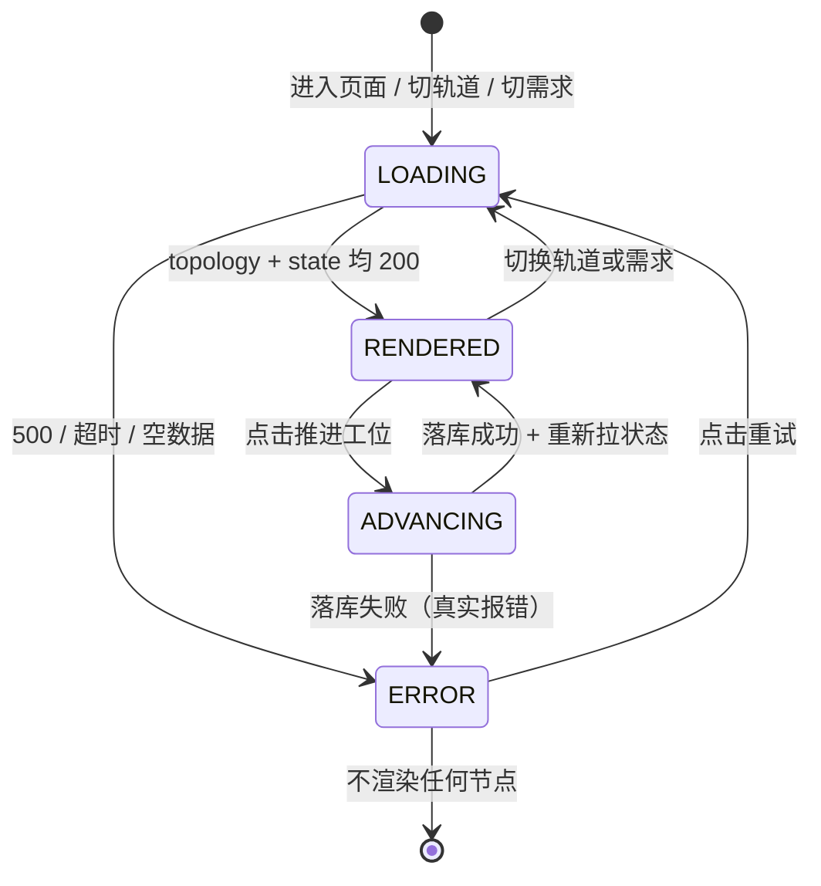

# 📐 软件需求规格说明书 (SRS): 工程流水线拓扑数据驱动改造

> **需求 ID**：`FR-REQ-WFC-02` ｜ **模块**：`req-management` / 页面 `/req/workflow`
> **上游契约**：[`prd-workflow-sop-data-driven-v1.0.md`](../../modules/req-management/prd-workflow-sop-data-driven-v1.0.md)
> **下游测试轨**：[`workflow-sop-data-driven-testcase.md`](../../test-cases/workflow-sop-data-driven-testcase.md)
> **参考基准**：[`WORKFLOW_GUIDE.md`](../../../../WORKFLOW_GUIDE.md) §2 / §8 / §9
> **阶段定位**：`[1]` 研发轨产出 · **只锁行为规格，不冻结表结构与接口字段**；DDL / 契约由 `[2]` 施工图决定

---

## 1. 修订历史

| 版本 | 日期 | 变更 | 作者 |
| :--- | :--- | :--- | :--- |
| v1.0 | 2026-11-06 | 首版：把「动态取数 + 参考 0~13 全流程」转译成可测量规格，锁定 16 篇口径、双轨、错误态与禁止兜底数据 | AI 辅助 / 待用户复核 |

---

## 2. 概述

### 2.1 目的

让 `/req/workflow` 的 X6 拓扑从「前端写死的演示稿」变成「数据库驱动、每个需求有独立真实进度的状态机」。本文件给出 `[2]` 出施工图、`[3]` 编码、`[6]` 联调、`[7]` 验收共用的验收尺子。

### 2.2 术语（白话优先）

| 术语 | 白话解释 |
| :--- | :--- |
| 流程定义 | 「有哪些阶段、怎么连、每个阶段负责什么」这套固定说明，全系统共用一份 |
| 工位状态 | 「某个需求现在走到哪一步、每步做完没有」，每个需求各一份 |
| 轨道 | L 级标准主链（0~9）与 S 级极速快轨（B1~B6）两套视图 |
| 兜底数据 | 接口没给数据时，前端自己编一份假节点/假人名填上 —— 本项目禁止 |
| 手抄第二份 | 同一份 SOP 说明在文档里一份、数据库里又手打一份，久了必然对不上 |

### 2.3 事实与口径

- 现行单一事实源：`.cursorrules §1` + `.ai/sop/*.md`，实测 **16 篇**（`[0]~[9]` 共 10 篇 + `[B1]~[B6]` 共 6 篇）。
- `WORKFLOW_GUIDE.md` §8 的 N00~N13 为**旧编号**（N2 标「`[3]` 编码」、N10 标「`[2]` 方案」），只作内容字典，不作节点 ID 来源。
- 指南 §9 明确：SOP 索引由 `sync_tree.py` 从 `.ai/sop/*.md` 实时生成，**请勿手抄第二份** —— 这条治理原则必须体现在同步机制里。
- 数据库现状：`docs/db/service.sql` 有 8 张 `t_req_*` 表，**无流程定义表、无工位状态表**；`docs/db/migrations/` 目录不存在。

---

## 3. 现状约束与向后兼容

| 约束 | 内容 |
| :--- | :--- |
| 必须保持 | Task-510 冻结的画布契约：可视框 360px、两层 DOM、`autoResize:false`、原生 `overflow:auto`、`WORKFLOW_CANVAS={1450,520}` |
| 必须保持 | L/S 双轨切换按钮与 360px 内的滚动 / 平移 / 节点拖拽 / Ctrl+滚轮缩放 |
| 必须退役 | `.ai/dags/dag_<code>.json` 与 `.ai/dag_state.json` 的读写（改为落库；退役策略由 `[2]` 定） |
| 必须删除 | 前端 `pipelineNodes` / `fasttrackNodes` 数组与 `createGraphNode('SOP-..')` 字面量调用 |
| 必须修正 | `current_node` / `activeNode` 字段错位、接口失败弹成功、`ownerName \|\| '张工'` 等兜底假值 |
| 工程红线 | 零新依赖、最小改动、禁假数据、建表必须配 rollback 脚本、生产写操作二次确认 |

---

## 4. 软件规格（每条带可验证断言）

### 4.1 数据来源规格

| 规格 ID | 规格描述 | 验证方式 |
| :--- | :--- | :--- |
| `SRS-01` | 节点、连线、大区、文案、Skill、产物、门禁**全部来自接口响应**，前端不保留任何流程节点字面量 | 源码 grep 无 `pipelineNodes` / `fasttrackNodes` / `createGraphNode('SOP-`；断网时画布为空且报错 |
| `SRS-02` | 流程定义与工位状态**都持久化在 MySQL**，不依赖本地 JSON 文件 | 推进工位后查库确认记录；删掉/改名 `.ai/dag_state.json` 后页面状态不变 |
| `SRS-03` | 工位状态按 `(reqCode, track, stageCode)` 唯一且需求间隔离 | 同一阶段在 REQ-001 与 REQ-002 下设置不同状态，互不覆盖 |
| `SRS-04` | 一次请求返回整套拓扑（节点 + 连线 + 大区），不做逐节点 N+1 | 抓网络请求：加载一个轨道的拓扑请求数为 1 |

### 4.2 口径与内容规格

| 规格 ID | 规格描述 | 验证方式 |
| :--- | :--- | :--- |
| `SRS-05` | 节点 ID 集合严格等于现行 16 篇 `[0]~[9]` + `[B1]~[B6]` | 接口返回的 `stageCode` 集合比对；不得出现 `LM-xx` / `GATE-xx` / `TC-GEN` / `SIGN-OFF` |
| `SRS-06` | 每阶段的职责 / Skill / 产物 / 门禁取自指南 §8 全景表 | 逐行对照 §8 的 16 行，缺项或自造内容判不通过 |
| `SRS-07` | L 轨与 S 轨各返回独立定义，切换后无上一轨残留 | 切换前后节点 ID 集合分别等于 10 篇 / 6 篇，且 DOM 中无旧节点 |
| `SRS-08` | 流程定义可从 `.ai/sop/*.md` 同步，不产生第二份手抄数据 | 新增/改名一篇 SOP 后执行同步，库中定义随之变化；同步前后 16 篇标题一致 |

### 4.3 状态与交互规格

| 规格 ID | 规格描述 | 验证方式 |
| :--- | :--- | :--- |
| `SRS-09` | 切换需求时拉取该需求的真实状态，不再按 `req.status` 在浏览器本地推测 | 源码无 `handleSelectWorkflowReq` 里的批量 `status` 赋值；DB 改状态后刷新页面随之变化 |
| `SRS-10` | `POST advance` 成功后真实落库、前端重新拉状态；重复点击不产生重复记录 | 连点两次后查库该键只有一条；页面状态与库一致 |
| `SRS-11` | 新需求首次访问按定义初始化状态（首节点进行中、其余待开始），不写死在前端 | 新建一个 reqCode 后首次打开，状态符合初始化规则且库中有记录 |
| `SRS-12` | 轨道切换只取对应轨道的定义与状态，不串轨 | L 轨推进后切到 S 轨，S 轨状态不受影响；切回 L 轨状态仍在 |
| `SRS-13` | 沿用 Task-510 的 360px 画布：滚动 / 平移 / 拖拽 / 缩放不回归 | 复跑 `scripts/tests/test_workflow_canvas_viewport.py` 8 条探针全绿 |

### 4.4 失败与诚实性规格（本需求红线）

| 规格 ID | 规格描述 | 验证方式 |
| :--- | :--- | :--- |
| `SRS-14` | 接口 500 / 超时 / 返回空数据时，显示**明确错误态与重试入口**，不渲染任何节点、不静默降级 | 拦截接口返回 500/超时/空 data，断言画布节点数为 0 且错误提示可见 |
| `SRS-15` | 接口失败时**不得出现成功提示**，也不得写死兜底人名 / 日期 / 需求编号 | 源码无 `ElMessage.success` 出现在 catch 中；无 `\|\| '张工'` / `\|\| '2026-10-29'` / `\|\| 'REQ-001'` |
| `SRS-16` | 重试点成功后正常渲染，错误态消失 | 恢复接口后点击重试，节点数与状态正确 |
| `SRS-17` | 加载中有可见加载态，不出现「先画一批假节点再替换」 | 节流接口后观察中间态无节点 |

### 4.5 工程规格

| 规格 ID | 规格描述 | 验证方式 |
| :--- | :--- | :--- |
| `SRS-18` | 建表必须有 `V*.sql` 与同版本 `rollback_V*.sql` 配对且非空 | `docs/db/migrations/` 下文件存在且 rollback 非空，`gate.py --sql` 通过 |
| `SRS-19` | 不新增前端依赖、不升级 X6、不改 `board.py` 状态机语义 | `package.json` / 依赖锁文件 diff 为空 |
| `SRS-20` | 不改 `.ai/sop/*.md` 正文、不放开全屏路由 `overflow:hidden` | 代码 diff 核对 |

---

## 5. 概念数据模型（**字段留给 `[2]` 冻结**）

> 本节只说明「需要哪几类东西」，不写 DDL、字段名、类型与索引。SOP `[1]` 硬约束：需求未稳定前不进入技术选型。

| 概念实体 | 装什么 | 基数 | 来源 |
| :--- | :--- | :--- | :--- |
| SOP 节点定义 | 阶段编号、轨道、标题、职责、Skill、产物、门禁、角色、坐标、大区、排序、启用态 | 16 条（L 10 + S 6） | `.ai/sop/*.md` + 指南 §8 |
| SOP 连线定义 | 起点、终点、轨道、线型、颜色、标签 | 约 14 条 | 指南 §2 阶段流转 |
| 工位状态实例 | 需求编号、轨道、阶段、状态、操作人、更新时间 | 每需求 × 每轨道 × 每阶段 | 用户推进 / 首次初始化 |
| 流程当前焦点 | 需求编号、轨道、当前阶段、模式 | 每需求 × 每轨道 1 条 | 由状态派生或独立保存（`[2]` 定） |

**状态枚举**：`COMPLETED` / `IN_PROGRESS` / `PENDING`（沿用现行看板语义，不新增状态）。

---

## 6. 接口清单与错误语义（需求级）

| 接口 | 用途 | 成功 | 失败语义 |
| :--- | :--- | :--- | :--- |
| `GET /req/workflow/topology?track=` | 一次返回该轨道节点 + 连线 + 大区 + 文案 | 200 + 完整定义 | 非 200 → 前端错误态，不降级 |
| `GET /req/workflow/state?reqCode=&track=` | 返回该需求该轨道各阶段状态与当前焦点 | 200 + 状态集；首次访问按规则初始化 | 非 200 → 错误态 |
| `POST /req/workflow/advance` | 推进工位并落库 | 200 + 更新后状态 | 非 200 → **真实报错**，禁止假成功 |
| `POST /req/workflow/sync-from-sop` | 从 `.ai/sop/*.md` 重新同步定义 | 200 + 同步条数 | 非 200 → 报错且保留旧定义 |

> 具体路径、入参名、响应 Schema、错误码由 `[2]` 冻结；本表只锁定「有哪些能力与失败时必须怎样」。

---

## 7. 状态机与交互流程

**交互不变式**：错误态下画布节点数恒为 0；任何状态下 360px 可视框尺寸不变；推进失败不产生成功提示。

---

## 8. 非功能约束

| 类别 | 约束 |
| :--- | :--- |
| 性能 | 单轨道拓扑一次请求返回；静置 3 秒画布尺寸方差为 0（沿用 Task-510 探针） |
| 一致性 | 状态键唯一，重复推进幂等；切需求不串状态 |
| 可维护 | 流程定义只有一处源头；改 SOP 后通过同步更新，禁止手工改库造第二份 |
| 可回滚 | 建表 SQL 必须配同版本 rollback；`[9]` 三级回滚预案覆盖本次 Migration |
| 工程红线 | 零新依赖、最小改动、禁假 Mock、生产写操作二次确认 |

---

## 9. 追溯矩阵

| PRD 业务规则 | SRS 规格 | TC 用例 |
| :--- | :--- | :--- |
| `BR-01` | `SRS-01/04` | `TC-WFC2-HP-001`, `TC-WFC2-EX-001` |
| `BR-02` | `SRS-05` | `TC-WFC2-HP-002`, `TC-WFC2-EX-005` |
| `BR-03` | `SRS-06` | `TC-WFC2-HP-003` |
| `BR-04` | `SRS-07/12` | `TC-WFC2-UI-001`, `TC-WFC2-UI-002` |
| `BR-05` | `SRS-02/03/10/11` | `TC-WFC2-HP-004`, `TC-WFC2-HP-005`, `TC-WFC2-EX-004` |
| `BR-06` | `SRS-14/15/16/17` | `TC-WFC2-EX-001/002/003`, `TC-WFC2-UI-004` |
| `BR-07` | `SRS-08` | `TC-WFC2-HP-006` |
| `BR-08` | `SRS-15` | `TC-WFC2-EX-005`, `TC-WFC2-EX-006` |
| `BR-09` | `SRS-13` | `TC-WFC2-UI-005`, `TC-WFC2-EX-007` |
| `BR-10` | `SRS-18` | `TC-WFC2-EX-008` |

---

## 10. `[2]` 待决技术项（本阶段不下结论）

| 编号 | 待决问题 | 为何留给 `[2]` |
| :--- | :--- | :--- |
| `TD-01` | 4 类概念实体落成几张物理表、字段 / 类型 / 索引 / 唯一键 | 属数据模型冻结，`[2]` 必含节 |
| `TD-02` | Migration 版本号与 `rollback_V*.sql` 的具体内容 | 需与现有 `service.sql` / `base.sql` 对齐 |
| `TD-03` | 接口路径、入参名、响应 Schema、错误码 | 契约冻结是 `[2]` 的核心职责 |
| `TD-04` | 节点坐标存库还是由前端布局算法根据 `sortNo` 计算 | 影响表字段与前端职责划分 |
| `TD-05` | `sync-from-sop` 是否纳入首版；解析 `.ai/sop/*.md` 的字段抽取规则 | 涉及解析器实现与运维入口 |
| `TD-06` | 旧 `.ai/dag_state.json` 的迁移 / 只读兼容 / 退役策略 | 需评估历史数据是否要导入 |
| `TD-07` | 「流程当前焦点」独立存表还是由状态实例派生 | 影响一致性与并发更新方案 |
| `TD-08` | 新需求首次初始化的触发点（后端惰性初始化 vs 显式接口） | 影响接口数量与事务边界 |

**已识别风险**：若只在前端把硬编码数组换成 `fetch` 却在失败时仍填一份本地节点，等于换汤不换药，`TC-WFC2-EX-001` 会直接拦截；若不建表而继续写 `.ai/*.json`，`TC-WFC2-EX-004` 会拦截。
