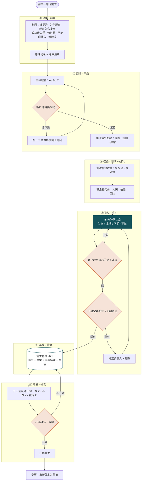

# 客户需求确认流程（一句话需求 → 基线 v0.1）

> 用途：内部培训 / 需求基线会 / 与客户对齐时使用。
> 核心主张：**确认不是签字，是让双方对"做成什么样"有同一张图。**

## 四个校验点（这张图真正的价值）

| 校验点 | 判据 | 不过怎么办 |
| :--- | :--- | :--- |
| **E 选得出吗** | 客户能不能在三种理解里指出一种，并说出为什么 | 不要继续追问，补一个具体场景例子 |
| **J 复述得出吗** | 客户能否用自己的话讲清"这版做什么、不做什么" | 回确认会，重新解释或精简选项 |
| **K 不确定项收敛吗** | 每条"暂定"都有负责人和期限 | 当场指定，否则它会变成开发期的阻塞 |
| **N 反述一致吗** | 研发复述的三句，产品是否全部认可 | 回基线修正，别带着误解开工 |

## 三个判断原则

1. **确认物是三件套**：原型回答"长什么样"，清单回答"做到什么程度"，验收标准回答"怎么算过"。只有原型不算确认。
2. **确认人要有拍板权**：业务拍板人、验收人、使用者，三种人确认的东西不一样。
3. **勾选要带代价**：用「本期 / 下期 / 不做」替代「要 / 不要」，否则客户全勾。

## 角色分工

| 环节 | 主责 | 参与 | 产出 |
| :--- | :--- | :--- | :--- |
| ① 采集 | 前场 | 产品 | 原话 + 七问 |
| ② 翻译 | 产品 | 客户 | 三种理解 → 清单初稿 |
| ③ 校验 | 测试 / 研发 | — | 验收层 + 代价列 |
| ④ 确认 | 客户 | 前场 / 产品 | 勾选 + 复述 |
| ⑤ 基线 | 产品 | — | 基线 v0.1 |
| ⑥ 开发 | 研发 | 产品 | 反述 + 代码 |

> AI 的位置：生成七问清单、生成三种理解、出可点原型、写基线文档、标来源。
> 不让位给 AI 的三件事：**取舍、拍板、验收。**
