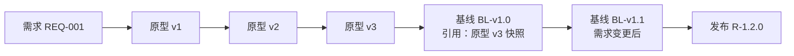
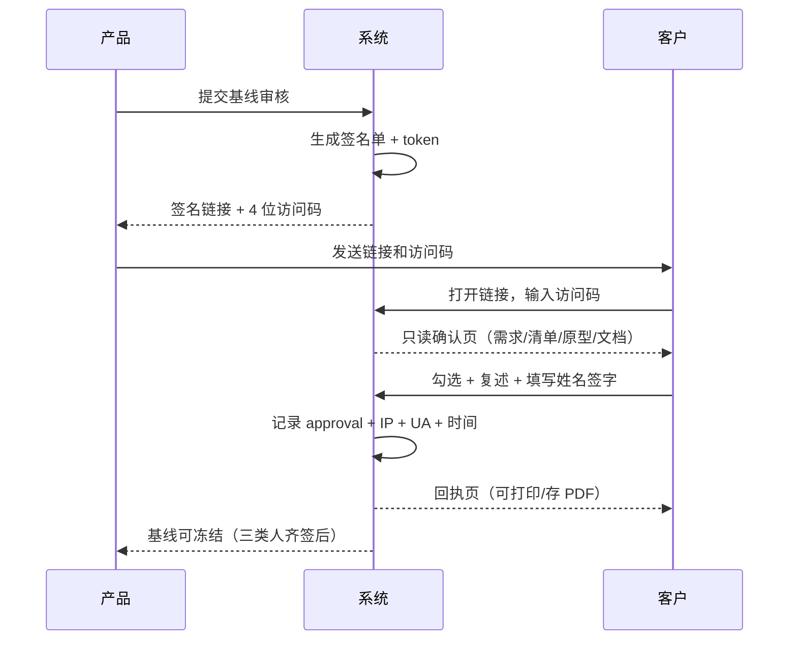
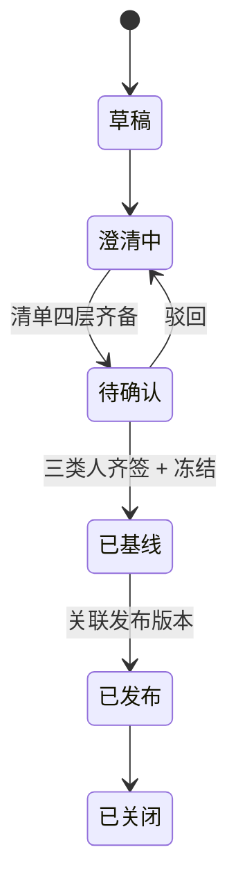

# 需求与版本管理平台 · 蓝皮书 v0.2

> **定位**：聚焦版蓝图，可直接进入排期。
> **一句话**：管住 **需求 · 版本 · 原型** 三件事，做到 **留痕、可确认、可追溯**。
> **变更**：v0.1 是全景版（含追溯矩阵、证据链、度量、客户门户）；v0.2 按实际诉求砍到 6 个对象、4 个视图、3 周 MVP。

---

## 0. 一页纸

**系统只回答三个问题：**

| 问题 | 谁问 | 靠什么回答 |
| :--- | :--- | :--- |
| 这个需求当时是谁确认的？ | 客户/老板/审计 | 签名记录 + 时间 + IP + 快照 |
| 确认的是哪一版？ | 研发/测试 | 基线 manifest + 文件 hash |
| 客户当时点的原型长什么样？ | 所有人 | 原型快照归档 zip |

**能回答这三条，系统就有存在价值。答不上，Excel + 网盘更划算。**

**范围**

- ✅ 管：项目、需求、确认清单、基线、原型、设计文档（上传）
- ❌ 不管：任务、代码、测试用例、缺陷、甘特拖拽、度量、AI 自动生成

**三个决定**

1. 原型**托管在系统里**并在线预览（iframe），不只存链接——否则快照无从谈起。
2. 客户**不登录**，用一次性签名链接完成确认。
3. 基线 = **Git tag + manifest + 归档快照**，冻结后不可变。

---

## 1. 三种版本，必须分开

这是整个系统最容易做错的地方。

| 版本类型 | 标识 | 产生时机 | 可变性 |
| :--- | :--- | :--- | :--- |
| **原型版本** | `mockup v1 / v2 / v3` | 产品每次改原型 | 可变，可无限迭代 |
| **基线版本** | `BL-v1.0` | 客户签字确认时 | **不可变** |
| **发布版本** | `R-1.2.0` | 对外交付时 | 不可变，可回滚 |

关系：



**规则**：一个基线只能引用**某一个**原型版本；改了原型就要出新的原型版本，不能覆盖旧的。

---

## 2. 核心机制 A：原型托管与快照

### 2.1 存储结构

```
projects/<PROJECT_KEY>/prototypes/REQ-001/
├── v1/
│   ├── mockup.html
│   └── assets/
├── v2/
│   ├── mockup.html
│   └── assets/
└── v3/                    ← 被基线引用
```

- 每次上传新版本 → 新目录 `v<N>`，**旧版本永不覆盖**；
- 预览：`/preview/{project}/{req}/{version}/mockup.html`，用 iframe 内嵌，只读；
- 静态资源走同一个路径前缀，保证相对引用不断。

### 2.2 快照怎么做

基线冻结时：

1. 按文件路径排序，逐个计算 `sha256`；
2. 生成 `manifest.json`（见附录 A）；
3. 整个目录打包 `REQ-001-v3.zip`，存对象存储（长期保留）；
4. `manifest_hash` = 对 manifest 内容再算一次 sha256，写入基线记录。

**效果**：即使有人后来改了 `v3` 目录（技术上应禁止，但防不住运维手滑），基线仍能用 zip 还原出当时的样子，并校验 hash 是否一致。

### 2.3 为什么必须托管

| 方案 | 能否追溯 | 问题 |
| :--- | :--- | :--- |
| 只存链接（Figma/内网地址） | ❌ | 链接会失效、内容会变 |
| 存截图 | ⚠️ | 只能看，不能点，交互态丢失 |
| **托管 + 快照** | ✅ | 可点、可还原、可校验 |

---

## 3. 核心机制 B：签名链接（客户不登录）

### 3.1 流程



### 3.2 签名页内容（只读，不可编辑）

| 区块 | 内容 |
| :--- | :--- |
| 抬头 | 项目名、需求编号与标题、**客户原话** |
| 确认清单 | 四层条目 + 客户本次勾选结果（本期/下期/不做） |
| 原型 | iframe 预览指定版本，可点，不可改 |
| 文档 | 技术方案/概要/详细设计附件（只读下载） |
| 复述 | 文本框，客户用自己的话写一遍 |
| 签字 | 三类人：业务拍板人 / 验收人 / 使用者代表（姓名 + 勾选确认 + 时间） |

### 3.3 留痕字段

```
approval {
  baseline_id, role, name, decision,
  ip, user_agent, token, signed_at,
  restatement_text, item_snapshot_json
}
```

`item_snapshot_json` 保存**签字那一刻的清单内容**——因为清单之后可能被改，但签字时看到的东西必须可还原。

### 3.4 安全措施（不登录的代价与对冲）

| 风险 | 措施 |
| :--- | :--- |
| 链接被转发 | 4 位访问码单独发送 + 有效期默认 7 天 + 可随时撤销 |
| 截图外泄 | 页面加水印（项目 + 需求编号 + 访问时间） |
| 误签 | 签字前强制勾选"我已阅读并理解"，且必须填写复述 |
| 抵赖 | 记录 IP/UA/时间/token，回执页带校验码 |
| 重复签署 | 同一角色签完后锁定，改需"撤销重签"并留痕 |

> 客户不登录，换来的是**零培训成本**；代价是**链接即凭证**，所以访问码、有效期、撤销三件套必须有。

---

## 4. 核心机制 C：基线冻结与差异

### 4.1 冻结条件

| 条件 | 说明 |
| :--- | :--- |
| 清单四层齐备 | 范围/规则/异常/验收都有条目 |
| "本期不做"≥3 条 | 防止范围未收敛 |
| 三类确认人已签 | 业务拍板人 / 验收人 / 使用者 |
| 原型已选定版本 | 明确引用 `v<N>` |
| 文档已挂载 | 至少一份技术方案或设计说明 |

### 4.2 冻结动作

```
1. 生成 manifest（含所有文件 sha256）
2. 打包原型目录 → 对象存储
3. 打 Git tag：bl/<PROJECT>/<REQ>/v1.0
4. 写入 baseline 记录（状态：已冻结）
5. 记事件：baseline.frozen
```

### 4.3 差异视图（MVP 必须有）

对比两个基线，输出三类差异：

| 差异类型 | 展示 |
| :--- | :--- |
| 清单条目 | 新增 / 删除 / 决定变更（本期→下期） |
| 原型 | 引用的版本号 + 文件 hash 是否变化 |
| 文档 | 新增 / 替换（按 hash 判断） |

**这是系统最值钱的一屏**——它回答了"这次改了什么"，比任何会议纪要都硬。

---

## 5. 核心机制 D：设计文档上传

**只存不解析。** 不做在线编辑、不做文档解析、不做自动抽取。

| 字段 | 必填 | 说明 |
| :--- | :--: | :--- |
| 文档类型 | ✅ | 技术方案 / 概要设计 / 详细设计 / 测试报告 |
| 关联对象 | ✅ | 必须挂到某个需求或基线，否则不允许上传 |
| 版本 | ✅ | `v1.0`，同类型同版本不允许重复 |
| 上传人 / 时间 | ✅ | 系统自动 |
| 文件 | ✅ | pdf / docx / pptx / md |
| 备注 | ❌ | 变更原因 |

**预览策略**：PDF 浏览器内嵌；docx/pptx MVP 只提供下载（不做转换，省掉一个重依赖）。

**冻结规则**：基线冻结时，所有关联文档的 `sha256` 写入 manifest。之后替换文件只影响新基线，历史基线永远指向旧 hash。

---

## 6. 数据模型（6 张表）

```sql
project(id, key, name, client, status, created_at)

requirement(
  id, project_id, code, title, raw_quote, trigger_event,
  status, owner_id, created_at, updated_at)

confirm_item(
  id, requirement_id, category, question, options_json,
  decision, cost_days, decided_by, decided_at)

prototype_version(
  id, requirement_id, version_no, dir_path, file_hash,
  uploaded_by, uploaded_at, preview_url)

baseline(
  id, project_id, requirement_id, version, git_tag,
  manifest_path, manifest_hash, status,
  signed_at, frozen_at, superseded_by)

artifact(               -- 设计文档 + 原型归档包
  id, project_id, requirement_id, baseline_id,
  type, version, storage_path, sha256,
  uploaded_by, uploaded_at, note)

approval(
  id, baseline_id, role, name, decision,
  ip, user_agent, token, signed_at,
  restatement_text, item_snapshot_json)
```

> `artifact` 同时承担"设计文档"和"原型归档包"，用 `type` 区分（`design/tech/arch/proto_zip`）。

---

## 7. 状态机



基线自身：`草案 → 待签 → 已签 → 已冻结 → 已替代`

---

## 8. 页面清单（4 个主视图 + 3 个详情）

| # | 页面 | 核心内容 |
| :--: | :--- | :--- |
| 1 | 项目工作台 | 需求列表（按状态）、基线数、待签数 |
| 2 | 需求详情 | 原话 + 清单四层 + 原型历史 + 文档 + 基线列表 |
| 3 | 基线详情 | manifest、签字状态、**差异对比入口** |
| 4 | 版本时间线 | 基线点 + 发布点，横向时间轴 |
| 5 | 原型预览 | iframe 全屏，带版本切换 |
| 6 | 签名页（外链） | 只读确认 + 勾选 + 复述 + 签字 |
| 7 | 签名回执 | 可打印 PDF，含校验码 |

---

## 9. 技术方案

| 层 | 选型 | 说明 |
| :--- | :--- | :--- |
| 前端 | Vue 3 + Element Plus | 复用 `base_template/frontend` |
| 后端 | Spring Boot 3 + MyBatis-Plus | 复用 `platform-common` |
| 数据库 | MySQL 8 | 元数据 |
| 文件 | 本地磁盘 / MinIO | 原型目录 + 文档 + 归档 zip |
| Git | JGit | 打 tag、读提交 |
| 预览 | Nginx 静态服务 + iframe | 原型直接托管 |
| 签名 | HMAC token + 4 位码 | 无需账号体系 |

**部署**：Docker Compose 三件套（web / api / mysql + minio），内网可离线。

---

## 10. 三周 MVP

| 周 | 交付 | 验收 |
| :--: | :--- | :--- |
| **W1** | 项目/需求/清单 CRUD；原型上传与 iframe 预览；版本目录隔离 | 能建一个项目、录一条需求、传两版原型并来回切 |
| **W2** | 基线冻结（manifest + zip + tag）；签名链接 + 签名页 + 回执 | 客户用链接完成签字，基线自动冻结 |
| **W3** | 文档上传与关联；基线差异对比；时间线；审计事件 | 能对比 v1.0 与 v1.1，说出改了什么 |

**W3 结束的验收场景（一句话）**：
> 拿一个真实需求，从录原话 → 传原型 → 客户签名 → 冻结基线 → 改一版 → 再冻结 → 对比差异，全程不超过 20 分钟，且任意时刻能还原客户当时点的原型。

---

## 11. 不做什么（明确边界）

- ❌ 客户登录与账号体系（用签名链接替代）
- ❌ 任务/代码/测试用例管理（留在 `.ai` 与 Git）
- ❌ 文档在线编辑与解析
- ❌ 甘特图拖拽排期（只做只读时间线）
- ❌ 度量看板与追溯矩阵（V2 再看）
- ❌ AI 自动生成需求或签字

---

## 附录 A · manifest 结构

```json
{
  "project": "NET-SIM",
  "requirement": "REQ-001",
  "baseline": "v1.0",
  "created_at": "2026-11-02T10:00:00+08:00",
  "prototype": {
    "version": "v3",
    "dir": "prototypes/REQ-001/v3",
    "files": [
      {"path": "mockup.html", "sha256": "..."},
      {"path": "assets/style.css", "sha256": "..."}
    ],
    "archive": "artifacts/REQ-001/v3.zip"
  },
  "documents": [
    {"type": "tech", "version": "v1.0", "path": "...", "sha256": "..."}
  ],
  "items_hash": "...",
  "approvals": [
    {"role": "business_owner", "name": "张工", "at": "..."},
    {"role": "acceptor", "name": "李工", "at": "..."},
    {"role": "user_repr", "name": "王工", "at": "..."}
  ],
  "not_in_scope": ["历史曲线", "导出", "权限分级"]
}
```

## 附录 B · 事件类型

`req.created` `req.updated` `proto.uploaded` `proto.previewed`
`baseline.submitted` `link.viewed` `approval.signed` `approval.revoked`
`baseline.frozen` `baseline.superseded` `doc.uploaded` `release.created`

## 附录 C · 目录结构

```
projects/<PROJECT_KEY>/
├── requirements/REQ-001.md
├── prototypes/REQ-001/v1|v2|v3/
├── documents/REQ-001/tech-v1.0.pdf
├── baselines/v1.0/manifest.json
└── releases/R-1.2.0.md
```

## 附录 D · 从 v0.1 砍掉了什么

| 砍掉 | 原因 | 何时再看 |
| :--- | :--- | :--- |
| 追溯链（需求→任务→代码→用例） | 依赖 `.ai` 深度集成，MVP 代价过大 | V2 |
| 证据链（门禁/测试/部署报告） | 同上，且可先用附件凑 | V2 |
| 度量看板 | 数据量不足，先攒三个月 | V2 |
| 甘特拖拽 | 只读时间线已够用 | V2 |
| 客户账号体系 | 签名链接更轻，客户零培训 | 永久不做 |
| 多租户计费 | 内部系统，无此需求 | 不做 |
